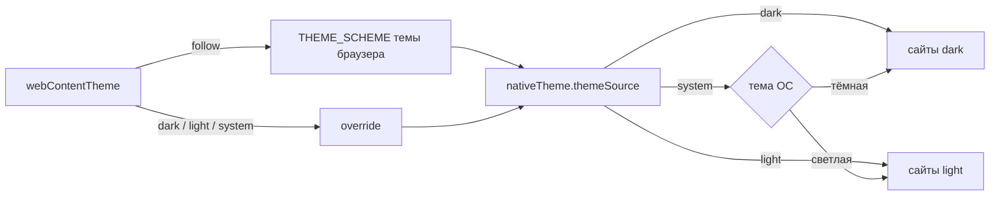

# 🎨 Темы

Документ описывает темы браузера: набор, резолв, применение к сайтам, окнам расширений и внутренним страницам.

## 🧩 Набор тем

Тема интерфейса: `dark`, `light`, `system`, `slate`. Хранение идет в `settingsStore.ts`, shell читает через `useTheme.ts`, оверлей через payload, внутренние страницы через канал `theme:page`.

Базовая тема веб-контента: `follow`, `dark`, `light`, `system` (поле `webContentTheme` там же). Она задает схему сайтов и окон расширений и не меняет интерфейс браузера.

Обе настройки принадлежат **рабочему пространству**: у каждого своя тема, и она не перетекает в окна соседнего пространства (см. [WORKSPACES.md](../workspaces/WORKSPACES.md)).

## 🔄 Резолв

Тема интерфейса `system` резолвится в `dark` или `light`: main через `nativeTheme`, renderer через `matchMedia`. `slate` остается собой везде, кроме веб-контента, где получает базу `dark`.

У каждой темы объявлена база в `THEME_SCHEME` (`browserTheme.ts`): `dark -> dark`, `light -> light`, `slate -> dark`, `system -> system`. Цветная тема обязана объявить базу явно: `prefers-color-scheme` знает только `dark` и `light`, и без записи в таблице новая тема молча получит `dark`.

Тема ОС для резолва `system` читается отдельно (переменная `osDark`): `nativeTheme.shouldUseDarkColors` отражает `themeSource`, а не ОС, поэтому при выставленном override по нему системную тему не узнать.

## 🌐 Сайты и окна расширений

Схема веб-контента ставится двумя механизмами, и одного мало.

`nativeTheme.themeSource` переключает `prefers-color-scheme` во всех webContents сразу, включая уже загруженные: по нему выбирает палитру большинство сайтов (GitHub, Wikipedia, MDN). Смена доезжает до renderer асинхронно.

CSS-свойство `color-scheme` задает used-схему документа: цвет ползунка, форм, канваса и ветку `light-dark()` / системных цветов. Применяется инъекцией `insertCSS` — синхронно, поэтому действует с первой же перезагрузки. Медиазапрос оно не переключает: без `themeSource` сайты на media-запросах остались бы от темы ОС.

`browserTheme.ts` держит обе точки: `applyWebContentSchemeFor(wsId)` (themeSource) вызывается при старте — до первого окна, иначе первая вкладка отрисуется по теме ОС — при смене темы и при смене фокуса окна (`syncProcessScheme`); `applyThemeToTab(rec, wsId)` (инъекция) — при создании вкладки и на каждом `did-finish-load`, поэтому первая же перезагрузка после смены темы даёт верную used-схему. Смена темы ОС при `system` пересчитывается через `nativeTheme.updated` и перекрашивает вкладки всех открытых пространств.

### Граница: `themeSource` один на процесс

`nativeTheme.themeSource` — состояние Chromium, а не окна: поставить разную схему `prefers-color-scheme` двум пространствам одновременно нельзя технически. Поэтому разделение такое:

| Механизм | Область | Кто задаёт |
|---|---|---|
| `themeSource` (`prefers-color-scheme`) | весь процесс | пространство ФОКУСИРОВАННОГО окна (`syncProcessScheme` на `focus`, на старте и на смене темы) |
| инъекция `color-scheme` (used-цвета) | каждая вкладка | своё пространство (`schemeForWorkspace(wsId)`) |
| фон view и окно попапа | каждая вкладка/окно | своё пространство (`viewBackgroundFor`, `webContentBackgroundFor`) |

Практическое следствие: used-цвета (полосы прокрутки, формы, канвас, `light-dark()`) у каждого пространства верные всегда, а `prefers-color-scheme` в НЕфокусированном окне другого пространства может отражать тему того окна, где сейчас работают. При клике в окно схема переставляется и сайт перекрашивается сам.

Нативный фон view красится через `viewBackgroundFor(url, wsId)` + `setBackgroundColor` при создании вкладки и при смене темы: иначе пустая view вспыхивает белым до первой отрисовки. Окно попапа расширения получает тот же цвет как `backgroundColor` и ту же used-схему через `insertCSS`.

Работает только для сайтов, которые уважают `prefers-color-scheme` или объявляют `color-scheme`. Сайты с захардкоженными цветами и `color-scheme: only light` не изменятся.

## 📄 Внутренние страницы

`konstruktor://` читают тему при загрузке через канал `theme:page` (main разрешает ее по теме интерфейса) и ставят `dataset.theme`. Базовая тема веб-контента на них не действует — настройка задана только для сайтов и окон расширений. `matchMedia` внутри страницы не годится: `themeSource` может быть перекрыт базовой темой, и медиазапрос вернул бы схему сайтов. При смене настроек main проставляет тему вживую через `executeJavaScript` без перезагрузки.
