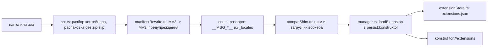
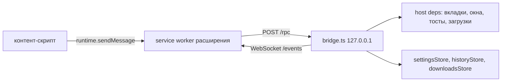
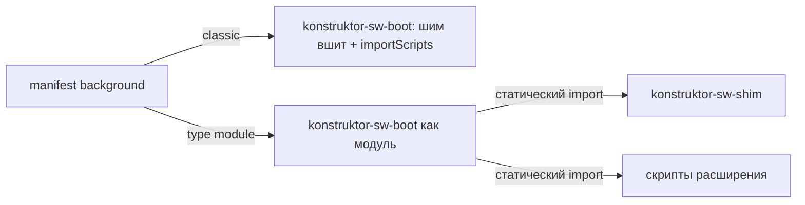
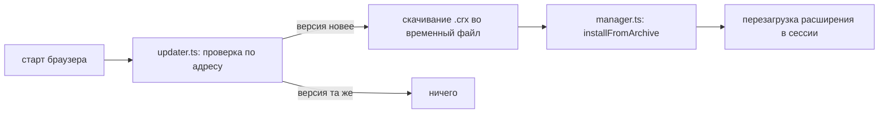
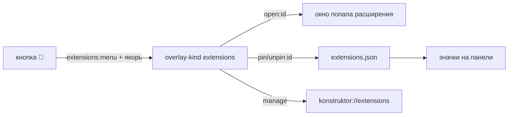

# 🧩 Расширения

Документ объясняет систему расширений: как устроены установка, загрузка и совместимость с Chrome, почему разработка ведётся через свой шим и loopback-мост и как подключается собственная экосистема `konstruktor.*`.

## 🧭 Назначение

Браузер принимает расширения двух видов. Первый — распакованные папки и архивы `.crx` из Chrome; они приводятся к Manifest V3 и получают недостающие API через слой совместимости. Второй — собственные расширения конструктора: у них есть секция `konstruktor` в манифесте и прямой доступ к системам браузера.

Ядро живёт в `src/main/extensions/`, реестр — в `extensions.json` в каталоге рабочего пространства, страница управления — `konstruktor://extensions`, кнопки расширений — на панели shell.

## 🗂️ Расширения и рабочие пространства

Расширения принадлежат ПРОСТРАНСТВУ, а не приложению: у каждого свой реестр (`workspaces/<wsId>/extensions.json`), свои файлы (`workspaces/<wsId>/extensions/<id>/`) и своя партиция. Поэтому одно и то же расширение в двух пространствах — это два независимых экземпляра с разными настройками и разными `electronId`.

Реестр хранит АБСОЛЮТНЫЕ пути (`dir`). Копирование каталога или реестра между пространствами без переписывания путей оставляет копию смотрящей в чужой каталог: при удалении источника расширение пропадает, а до тех пор два пространства делят одни файлы.

Копирование секции «Расширения» (`extensions/copy.ts`) делает три вещи: копирует каталоги под именем `id` (как при установке), переписывает `dir` на каталог целевого пространства и чистит `electronId` с `error`. `electronId` выдаётся при загрузке в партицию, и с чужим значением реестр считал бы копию уже загруженной и не загрузил её вовсе.

Мост loopback ОДИН на процесс и обслуживает расширения всех открытых пространств. `electronId` однозначен в пределах процесса, поэтому запись ищется во всех кэшах реестров (`findExtensionByElectronIdAny`), а не только в пространстве запуска. Поиск по одному пространству работал, пока открыто было одно: расширение второго при первом же вызове получало `unknown extension` и теряло меню, попап и хранилище. По той же причине хранилище `konstruktor.storage` адресуется КАТАЛОГОМ расширения, а не id в пространстве запуска.

## 🔒 Ограничения Chromium, от которых строится вся схема

Замеры на Electron 44.5.1 (Chromium 152). Три вывода определяют устройство системы:

- Контент-скрипты Manifest V2 в Chromium 152 не исполняются вообще. Расширение загружается, фон работает, но в страницы ничего не инжектится. Поэтому манифест **обязательно** переводится в MV3 — именно `manifest_version: 3` включает контент-скрипты.
- `registerPreloadScript` в service worker расширения не доходит, а мир preload для страниц расширения изолирован от скриптов самой страницы. Значит, мост из расширения в main можно построить только сетевым каналом.
- Расширения загружаются лишь в persistent-сессию: попытка загрузить расширение в in-memory партицию бросает `Extensions cannot be loaded in a temporary session`. Поэтому в инкогнито-окнах расширений нет — это поведение Chromium, а не дефект.

## 🏗️ Поток установки



`crx.ts` разбирает CRX3 и CRX2 сам: Electron `.crx` не понимает вообще. У CRX3 длина заголовка — обычный `uint32` с малым порядком, а не varint (varint идёт уже внутри полей protobuf); ошибка здесь даёт от `adm-zip` невнятное «Invalid CEN header». Полезная нагрузка — обычный zip, распаковка идёт по записям с проверкой пути, поэтому архив не может записать файл за пределы каталога расширения. Подпись не проверяется — это описано в разделе о нюансах.

Идентификатор берётся в порядке приоритета: `crx_id` из подписанной части заголовка CRX3 (читается минимальным сканером protobuf) → публичный ключ CRX2 → путь установки. Для боевых `.crx` из Chrome Web Store идентификатор совпадает с Chrome-идентификатором (`ddkjiahejlhfcafbddmgiahcphecmpfh` для uBlock Origin Lite — проверено).

После распаковки разворачиваются локализованные метаданные: `__MSG_extName__` и подобные подставляются из `_locales/<default_locale>/messages.json`. Без этого в списке расширений показывалось бы служебное имя (так было с uBlock Origin Lite).

`manifestRewrite.ts` переводит манифест и каждую деградацию записывает в `warnings` — пользователь видит их на карточке расширения. Хосты переносятся из `permissions` в `host_permissions`, фон подменяется сгенерированным загрузчиком, в первый блок каждого контент-скрипта добавляется файл шима.

Вырезается с предупреждением только то, что действительно перевести нельзя: `omnibox`, `chrome_url_overrides`, `externally_connectable`, `tts`, `tts_engine`. Молча — служебные ключи `browser_specific_settings`, `applications`, `nacl_modules`. Секция `commands` остаётся в манифесте: её читает свой перехватчик (см. «Клавиатурные команды»), а `update_url` в записанный манифест не попадает — адрес забирает наш `updater.ts`. Наличие в манифесте наборов правил блокировки (`declarative_net_request`) проверяется отдельно и даёт предупреждение (см. «Чего в этом Electron нет»).

Идентификатор считается от публичного ключа (первый блок SHA-256, полубайты в `a..p`) — так же, как в Chrome. Если ключа нет, он считается от пути установки, и путь при этом нормализуется (`resolve`): без этого одна и та же папка, указанная как «ext/demo» и как полный путь, давала два разных идентификатора и **две копии одного расширения в списке**. Регистр не трогаем: он часть ключа, и его смена дала бы ту же вторую копию.

## 🌉 Мост и шим совместимости



`bridge.ts` — HTTP-сервер на петле. Расширение вызывает main через `POST /rpc`, main пушит события через WebSocket на `/events`. Адрес и токен лежат в `extensions-bridge.json` в userData и переживают перезапуск: Chromium хранит регистрацию service worker'а расширения и поднимает её раньше, чем браузер успевает переписать шим, поэтому при случайном порте на каждый запуск воркер стучался бы в закрытую дверь.

Токен обязателен в каждом запросе, расширение определяется по заголовку `Origin` (`chrome-extension://<id>`) — по нему же проверяются права. Сервер слушает только `127.0.0.1`.

Шим (`compatShim.ts`) собирает отсутствующие `chrome.*` поверх RPC: `tabs.create/query/update/remove/reload`, `windows.*`, `action.*` с событиями, `contextMenus`, `notifications`, `alarms`, `commands`, `permissions`, `i18n.getMessage` (читает `_locales` с диска — только как запасной путь, см. ниже), `downloads.download`, `storage.sync` как псевдоним `storage.local`, `userScripts` поверх `chrome.scripting` (см. «Чего в этом Electron нет»). Родные API Electron не подменяются, если работают: шим достраивает, а не переписывает. Отдельно досыпаются константы-идентификаторы, которых в Electron нет: `tabs.TAB_ID_NONE` и `windows.WINDOW_ID_NONE` (обе `-1`). Без `TAB_ID_NONE` падают блокировщики: uBlock Origin Lite строит правило `declarativeNetRequest` с `condition.tabIds: [TAB_ID_NONE]`, а `undefined` в `tabIds` роняет `updateSessionRules` («expected integer, found undefined») — режим фильтрации для сайта не применяется и не сохраняется. Без `TAB_ID_NONE` падают блокировщики: uBlock Origin Lite строит правило `declarativeNetRequest` с `condition.tabIds: [TAB_ID_NONE]`, а `undefined` в `tabIds` роняет `updateSessionRules` («expected integer, found undefined») — режим фильтрации для сайта не применяется и не сохраняется.

**Синхронные API нельзя отдавать через RPC.** Мост асинхронен по устройству, а часть API Chrome синхронна. `chrome.i18n.getMessage` — из их числа, и в Electron он уже родной и рабочий (замер в воркере: `getMessage` — функция, вызов возвращает строку). Пока шим перекрывал его RPC-версией, расширение получало промис вместо строки: Tampermonkey склеивал из `getMessage` подписи меню попапа, и вместо текста появлялись `[object Promise]`, а после передачи через `runtime.sendMessage` (промис не клонируется) — `[object Object]`; рендер подсказки падал на `e.replace is not a function`. Правило: если API в Chrome синхронный, шим обязан сохранить синхронность — родной метод не трогается, RPC допустим только как запасной вариант при его отсутствии.

`permissions` в этом Electron нет вовсе, а расширения обращаются к нему на старте фона — uBlock Origin Lite падал на `browser.permissions.onRemoved`. Модель разрешений простая: объявленное в манифесте считается выданным, поэтому `getAll`/`contains` отвечают по манифесту, `request`/`remove` возвращают успех, а события существуют, но не срабатывают.

Пространство имён `browser` Chromium отдаёт, но населено оно частично: `browser.runtime` и другие обращения падали. Шим переносит в `browser` недостающие члены `chrome` — и в фоне, и в контент-скрипте. `browser.tabs`/`browser.windows` в Electron свои, поэтому цикл копирования их не трогает — константы-идентификаторы им досыпаются явно.

Загрузчик пишется в каталог расширения под именем `konstruktor-sw-boot-<отпечаток>.js`, и **имя файла меняется вместе с шимом и с файлами расширения**. Причина: Chromium хранит регистрацию service worker'а расширения в партиции вместе с картой подключённых модулей, и при неизменном URL скрипта продолжает исполнять старую версию из своего кэша. Оба случая замерены: после удаления отдельного `konstruktor-shim.js` воркер всё ещё обращался к нему и падал, а после правки `sw.js` расширения продолжал исполнять его прошлую версию — новый код запускался только после смены имени загрузчика. Поэтому отпечаток включает имена, размеры и время правки файлов расширения (служебные `konstruktor-*` исключены, иначе получился бы цикл). Другой URL заставляет Chromium поставить новую версию воркера.

По той же причине при каждой загрузке снимается прежняя регистрация расширения (`extensions.removeExtension`) перед `loadExtension`, а файлы прошлых версий загрузчика удаляются из каталога, чтобы не копить мусор в userData.

Побочный эффект этой пары `removeExtension` + `loadExtension` полезен: зарегистрированные расширением content-скрипты (`chrome.scripting.registerContentScripts` и, значит, `chrome.userScripts`) при перезагрузке расширения **сбрасываются** — замером после перезапуска они отвечают «Nonexistent script ID». Поэтому пользовательские скрипты не накапливаются между запусками и не инжектятся дважды.

В отпечаток входят только файлы самого расширения: служебные `konstruktor-*` и `manifest.json` исключены. Манифест исключён не для красоты — его мы перезаписываем на каждом старте (указатель на загрузчик), и его время правки менялось бы каждый запуск, а вместе с ним и имя загрузчика. Тогда Chromium на следующем старте восстанавливал бы регистрацию на уже удалённый файл: `DidStartWorkerFail` и падение фона (проверено: имя менялось между двумя запусками без единой правки кода).

### Что происходит при выходе

Расширения выгружаются перед выходом из приложения (хук `before-quit` в `main/index.ts`). Причина: Chromium хранит регистрацию service worker'а в партиции и на следующем старте поднимает её **сам**, до того как мы вызовем `loadExtension`. В этот момент расширение ещё не загружено, `chrome` в воркере лишён родных API, и фон падает — в логе это `Cannot read properties of undefined (reading 'onMessage')` вместе с `DidStartWorkerFail`. Замерено: со снятием регистраций при выходе следующий старт проходит без единой ошибки расширений.

### Сироты в партиции

Chromium помнит расширения отдельно от `extensions.json`: после удаления записи (или каталога) регистрация остаётся, и её воркер продолжает подниматься на каждом старте. Поэтому после загрузки наших расширений идёт сверка (`dropOrphanRegistrations`): всё, чего нет среди `electronId` реестра, снимается.

Источников списка два, и оба нужны. Публичный `getAllExtensions()` отдаёт только **успешно** загруженные расширения, а сироты как раз обычно ломаются: в живом профиле нашлась регистрация, чей воркер падал на каждом старте, и в `getAllExtensions()` её не было. Полный список лежит в `Preferences` партиции (`extensions.settings`) и читается как JSON без своей модели — формат внутренний, и при его смене источник просто тихо пропускается.

В каталоге расширения остаются только служебные файлы: `konstruktor-cs-shim.js` (контентный шим), `konstruktor-sw-boot-<отпечаток>.js` и у модульного фона `konstruktor-sw-shim-<отпечаток>.js`.

Обмен с мостом идёт через `fetch` из `chrome-extension://`, а это запрос в приватную сеть: Chromium требует успешный предварительный запрос CORS. На 404 он падал с «Response to preflight request doesn't pass access control check: It does not have HTTP ok status», и вызовы из расширения не проходили вовсе. Поэтому `bridge.ts` отвечает на `OPTIONS` кодом 204 с `Access-Control-Allow-Origin`, `-Methods`, `-Headers` и обязательным для loopback `Access-Control-Allow-Private-Network: true`.

## 🧩 Два вида фона

Манифест MV3 объявляет фон либо классическим, либо модулем (`background.type: "module"`). Случай не косметический: динамический `import()` в service worker запрещён спецификацией HTML и падает с «import() is disallowed on ServiceWorkerGlobalScope» — так uBlock Origin Lite терял фон целиком.



- **классический** — шим вшивается в загрузчик, скрипты расширения поднимаются `importScripts`;
- **модульный** — загрузчик сам является модулем и подключает шим и скрипты расширения **статическими** `import`; порядок гарантирован спецификацией (вычисление идёт в порядке перечисления), поэтому шим объявляет `chrome.*` раньше тела скриптов расширения. `type: "module"` при этом сохраняется в манифесте: без него Chromium грузит модульный загрузчик как классический, и `import` в нём не работает.

## ⌨️ Клавиатурные команды

Chromium в Electron не исполняет секцию `commands`, поэтому сочетания обслуживает браузер: `commands.ts` разбирает акселераторы манифеста, а перехват идёт по `input.code` (независимо от раскладки) в `before-input-event` вкладки и окна. Сработавшее сочетание уходит фону как `chrome.commands.onCommand`, а `chrome.commands.getAll` отвечает по записи реестра. Приоритет у браузера: горячие клавиши вкладок и окон проверяются раньше команд расширений. Регистрация ставится и снимается вместе с загрузкой и выгрузкой расширения.

## 🔄 Проверка обновлений

`updater.ts` проверяет обновления в фоне через `net.fetch` спустя задержку после старта. Адрес берётся из `update_url` манифеста, а если его нет — из точки обновления Chrome Web Store по идентификатору расширения. Новая версия скачивается во временный файл и ставится обычным путём (`installFromArchive`), поэтому обновление не отличается от установки. Обновления Chromium для расширений в Electron не работают вовсе — иначе вышло бы так, что расширение без нашего `updater.ts` остаётся на старой версии навсегда.



Проверка идёт с задержкой и без блокировки старта: сеть не должна задерживать открытие окна. Кнопка ручной проверки — на странице расширений, результат показывается числом обновлённых расширений.

## ⛔ Чего в этом Electron нет

Замеры пробником на Electron 44.5.1 (Chromium 152), от них зависят предупреждения на карточке расширения:

- `chrome.permissions`, `chrome.userScripts`, `chrome.webRequest`, `chrome.webNavigation`, `chrome.cookies`, `chrome.privacy` — API нет. Что можно, достраивает шим (`permissions` — и в фоне, и на страницах расширения; `userScripts` — см. ниже), остальное расширение не получит.
- `chrome.identity` **не шимится**, хотя разрешение `identity` в манифесте объявлено: ошибка `Cannot read properties of undefined (reading 'getProfileUserInfo')` приходит и от AHA Music (вход в аккаунт), и от других расширений. Для основной работы это не критично (AHA Music ищет музыку без него), поэтому вход остаётся недоступным, а ошибка видна в консоли.
- `chrome.scripting` **есть и работает фактически** (замер 2026-10-11): `registerContentScripts`, `getRegisteredContentScripts`, `unregisterContentScripts`, `executeScript`. Проверено не по наличию методов, а по эффекту: зарегистрированный файл исполнился в странице, причём MAIN-мир дал код в `window` страницы, а изолированный — нет (изоляция корректная). Если файла нет, Chromium возвращает «Не удалось загрузить JavaScript» — то есть API исполняется, а не отдаёт заглушку.
- **`chrome.userScripts` достраивается шимом поверх `chrome.scripting`** — только у расширений, объявивших `userScripts` в манифесте. Причина: это единственный штатный путь пользовательских скриптов, и без него Tampermonkey показывает «Allow User Scripts» (Q209) и не инжектит ничего. Отображение: `register`/`unregister`/`update`/`getScripts` — обёртки над одноимёнными методами `scripting`, `configureWorld` — заглушка. Мир `USER_SCRIPT` отображается в изолированный (полного соответствия нет: у мира Chrome свои правила доступа к странице и sandbox), `MAIN` — в `MAIN`.
  Одна тонкость про форму данных: `userScripts` принимает **текст** (`js: [{ code }]`), а `scripting` регистрирует только **пути** к файлам в каталоге расширения. Поэтому код сначала сохраняется файлом `konstruktor-us-<id>-<n>.js`, а запись делает main по RPC `shim.writeUserScriptFile` — у шима доступа к файловой системе нет, это код расширения. Имя ограничено шаблоном (`^konstruktor-us-[A-Za-z0-9_-]+\.js$`), чтобы исключить выход из каталога, а префикс `konstruktor-` держит эти файлы вне отпечатка загрузчика (см. ниже) — иначе каждая регистрация меняла бы имя загрузчика. Повторная регистрация того же `id` не ошибка: прежняя запись снимается перед новой, потому что расширения зовут `register` на каждом старте воркера.
  Чего не будет: `configureWorld({ csp, messaging })` не воспроизводится, `onBeforeScript` существует, но не срабатывает, а всё, что в пользовательских скриптах опирается на обход CORS (`GM_xmlhttpRequest`), упирается в отсутствие `webRequest`/`cookies`.
- **`chrome.scripting.executeScript({ target: { tabId } })` не работает**: `tabId` у расширения — идентификатор Chromium, а `tabs.query` моста отдаёт **наши внутренние** номера вкладок (`allocTabId`), и Chromium отвечает «No tab with id». Декларативная регистрация (`registerContentScripts`) идентификаторов не требует и работает, поэтому пользовательские скрипты этим не затронуты; точечная инъекция в конкретную вкладку — пока нет.
- **DNR-редирект работает** (замер 2026-10-11): правило `action: { type: 'redirect', redirect: { regexSubstitution } }` для `main_frame` действительно уводит навигацию на подставленный адрес (`example.com` → `example.org`). Это важно для Tampermonkey: установка скрипта по ссылке делается именно так — расширение ставит session-правила (замер: 24 redirect-правила) и уводит `*.user.js` на свою страницу установки. Отдельного разрешения это не требует; `web_accessible_resources` не нужен, так как цель правила — обычный `https`-адрес.
- **Страница расширения может закрыть свою вкладку сама** (`window.close()`): так Tampermonkey закрывает служебные окна (`ask.html`). Раньше это оставляло «призрачную» запись вкладки и роняло главный процесс — см. `TABS.md` («Вкладка может закрыться сама»).
- `chrome.offscreen` **есть**, но только у расширений, объявивших `offscreen` в манифесте (у остальных namespace `undefined`). Замер 2026-10-11: `createDocument` реально создаёт документ — в `getAllWebContents()` появляется `chrome-extension://<id>/offscreen.html` (проверено на Sound Booster и MetaMask).
- `chrome.tabCapture` **нет нигде** — ни в service worker, ни на страницах расширения (`tabCapture` = `undefined` при объявленном разрешении). Захвата звука отдельной вкладки в Electron не существует, и аналога у него нет: пераудиозахват — инфраструктура самого Chrome.
  Последствие для расширений, которым нужен звук вкладки: **не работают** те, что усиливают звук (Sound Booster, «Volume Master»), и те, что его распознают (AHA Music — слушает вкладку и ищет песню). Механика отказа разная и обе видна в замерах:
  - усилители просят у фона `getMediaStreamId`, получают ошибку и не создают `MediaStreamSource` — гейн не применяется ни к чему; побочно «слетает» ползунок, потому что значение живёт только в памяти offscreen-документа (`tabId → gain`) и в `chrome.storage` не пишется;
  - распознаватели зовут `chrome.tabCapture.capture({ audio: true })` из попапа — вызов падает с `TypeError: Cannot read properties of undefined (reading 'capture')` (замер на AHA Music 2.0.6).
  Обходного пути внутри расширения нет: `chromeMediaSource: 'desktop'` (loopback) в Electron захватывает **звук всей системы**, а не вкладки. Для распознавателей это ещё и опасно: AHA Music подключает полученный поток к `AudioContext.destination`, то есть играет захваченное обратно в колонки, — на loopback это дало бы второй экземпляр системного звука (эхо и задвоение). Для усилителей аналогично: воспроизведение системного микса ломает звук всех остальных приложений и вкладок. Отдельная функция, если понадобится, делается своим кодом (Web Audio на элементах `<video>`/`<audio>` страницы), а не через такое расширение.
- `chrome.tabs` на страницах расширения **урезан**: есть `query`/`reload`/`update`/`get`/`sendMessage`/`getZoom` и события, но нет `create` и `remove`. Досыпает preload попапа (`src/preload/popup/index.ts` — см. «Интерфейс»).
- `chrome.declarativeNetRequest` присутствует, но **наборы правил из манифеста не включаются автоматически**: объявленный набор не появляется в `getEnabledRulesets()`, а `testMatchOutcome` не находит совпадений, пока набор не включён. Динамические правила при этом работают — правило `updateDynamicRules` действительно отменяет запрос (он не доходит до сети). Для блокировщика это значит, что правила из его наборов не применяются, пока он сам их не включит; пока не включит — получает предупреждение «наборы правил блокировки не загружаются». Трансляция наборов в динамические правила невозможна: у блокировщиков десятки тысяч правил, а лимит динамических — 5000.
  Наборы при этом можно включить программно: они объявлены в манифесте **без** `enabled: true`, поэтому Chromium сам их не включает, а uBlock Origin Lite включает вызовом `updateEnabledRulesets`. Замером (2026-10-11) проверено, что после этого статические правила работают и блокируют запросы подресурсов, а `main_frame` не матчится. Пересмотреть предупреждение — план `docs/plans/DNR_BLOCKING_PLAN.md`.
- Контент-скрипты в MAIN-мире получают `chrome` без `runtime`, из-за чего часть кода расширений падает на `chrome.runtime.getURL`. Это ограничение Electron, а не шима: в MAIN-мире наш шим не может подменить `chrome`.

## ⭐ Собственная экосистема

Собственное расширение отличается секцией манифеста:

```json
"konstruktor": { "api": 1, "capabilities": ["settings", "storage", "tabs", "notify"] }
```

Фон такого расширения получает объект `konstruktor` с доступом к системам браузера: `settings.get/patch`, `tabs.list/open`, `history.query`, `downloads.list`, `storage.get/set/remove`, `notify`, `openExternal`. Каждая возможность проверяется мостом на каждом вызове по списку `capabilities`. Расширения без секции `konstruktor` собственный API не получают вообще — это отделяет чужие CRX от внутренностей браузера.

Данные `konstruktor.storage` лежат в `konstruktor-storage.json` рядом с установленным расширением.

Страницы собственного расширения отдаются по `konstruktor://ext/<id>/<файл>`: файл читается только из каталога расширения, попытка выйти через `..` возвращает 404.

Образца в репозитории нет: своё расширение достаточно собрать как обычное — положить `manifest.json` с секцией `konstruktor` и папку с кодом, затем установить её как распакованную.

## 🖥️ Интерфейс

`konstruktor://extensions` (пункт «Расширения» в меню ☰) показывает карточки: имя, версия, источник, разрешения, хосты, предупреждения совместимости и ошибку загрузки. Там же установка из папки и из `.crx`, тумблеры включения, перезагрузки, удаления, открытия папки, а также глобальный выключатель расширений и режим разработчика.

Доступ к расширениям во время работы даёт меню расширений — кнопка-пазл 🧩 справа от кнопки поиска, внутри адресной строки, как в Chrome и Яндекс Браузере. Меню построено как отдельный вид оверлея (`extensions` в `shared/overlay-types.ts`): список длиннее панели, а всё ниже инсетов перекрыто `WebContentsView`, поэтому рисовать его в shell нельзя.

Вид `extensions` — менюподобный: он забирает фокус у shell (иначе стрелки и Esc не доходят до списка) и обязан быть в обоих списках фокуса в `overlay/service.ts` — в том, что помечает передачу фокуса (`noteFocusHandoff`), и в том, что вызывает `focus()`. Пропуск первого списка выглядел как «меню не открывается»: родитель терял фокус, `closeIfFocusLeftApp` считал это уходом из приложения и гасил только что показанное меню — в логе `app left focus -> close overlay` и `closing` при пустом стеке.

Вторая половина того же симптома — на стороне renderer. Отрисовкой вида заведует общий реестр, и промаркировать вид в нем недостаточно: `propsFor` (`renderer/overlay/payload.ts`) обязан вернуть для него пропсы. Без отдельной ветки уровень возвращает `null`, `buildRenderedLevels` молча его отбрасывает, а окно открывается пустым — и подтверждает отрисовку, поэтому в логе нет ни ошибки, ни причины.



Строка меню показывает значок, имя, badge и количество заметок о совместимости. Клик по строке открывает попап расширения или шлёт фону `action.onClicked`, справа — только закрепление. В конце списка одна кнопка «Управление расширениями»: она открывает `konstruktor://extensions` тем же путём, что и пункт «Расширения» в меню ☰. Построчных действий над расширением в меню нет намеренно — настройки и удаление живут в карточке на самой странице, а наведение мышью, при котором такие кнопки становились видимыми, превращало список в рябь.

Закреплённые расширения дополнительно видны на панели (значки `ExtensionActions.vue`), остальные живут только под пазлом. Закрепить можно лишь расширение с `action`: без значка закреплять нечего.

Значок и подпись берутся из двух источников, в порядке приоритета: живое состояние моста (что расширение задало вызовами `action.setIcon`/`setTitle`/`setBadgeText`), затем `actionSeed` реестра — снимок `action` из манифеста, снятый при установке. Реестр нужен именно потому, что живое состояние не переживает выключения: `disableExtension` снимает запись из Map моста, а расширения остаются на странице и в меню. Привязки этой пары к `electronId` быть не должно — загрузка в сессию к значку отношения не имеет. Пока связь была, у выключенного расширения `action` целиком становился пустым, и на месте значка появлялась первая буква имени (замер: uBlock Origin Lite, выключен, `action.icon` — 2918 символов, до правки — пусто).

Попап расширения открывается отдельным frameless-окном (`popup.ts`) с той же партицией, что и вкладки. Позиция — под значком с клампом по рабочей области; закрывается по потере фокуса (первое событие `blur` игнорируется, иначе попап закрывался бы от передачи фокуса от родительского окна).

В окно попапа ставится свой preload (`src/preload/popup/index.ts`). Он патчит три вещи в мире страницы, без которых попапы блокировщиков не работают:

- `tabs.query`. Расширения зовут `tabs.query({ active: true, currentWindow: true })`, чтобы узнать вкладку пользователя. Попап — отдельное окно, «текущим окном» оказывается он сам, и вкладкой — его собственная страница (`chrome-extension://…`). uBlock Origin Lite на этом рисует «not a website» вместо панели. Preload подменяет ответ на вкладку, из-под значка которой попап открыт (её main передаёт синхронным IPC `popup:tab-info`: `additionalArguments` до preload'а не доходят). Подменённый метод принимает **обе** формы вызова — с колбэком и без, как Chrome: расширение, позвавшее `query(info, cb)`, иначе не получило бы ответ никогда (промис оно не смотрит, а колбэк не вызывается). Именно на этом зависал поиск музыки в AHA Music: попап показывал «слушаю» бесконечно, потому что её `queryTab()` не завершался.
  В синтетический Tab входит `audible` — реальный признак звука активной вкладки (main кладёт его в `popup:tab-info`). Поле не косметическое: AHA Music отказывается искать музыку у «молчащей» вкладки, и с жёстким `false` (как было) он не доходил до сути. Обратите внимание: `id` вкладки здесь — webContents активной вкладки, а не наш внутренний номер, потому что попапу этот id нужен для своих вызовов.
- Первое `runtime.sendMessage`. У только что загруженной страницы попапа оно не доставляется — промис не разрешается никогда, пока поднимается фоновый service worker; тот же вызов через ~300 мс проходит. uBlock на этом залипает в состоянии `loading`. Preload пропускает первое сообщение через прогрев: безобидный пинг с `:` в `what` (фон его игнорирует), затем таймаут-страховка.
- `permissions`. Chromium в Electron не отдаёт `chrome.permissions` ни в фоне, ни на страницах расширения, а попап им пользуется сам: uBlock Origin Lite просит разрешение на хост, когда пользователь поднимает ползунок фильтрации выше «базового» уровня. Запрос вылетал исключением внутри `try/catch` расширения, результат оставался falsy — и uBlock откатывал ползунок в исходное положение, из-за чего уровень не менялся вообще. Preload достраивает API по модели шима фона (объявленное в манифесте считается выданным, `request`/`remove` — успех).

Размер попапа берётся из `body` страницы: у попапа фиксированная ширина панели, а `documentElement` растянут на всё окно и вернул бы размер самого окна.

Одного замера недостаточно, и это не тонкость, а причина видимого дефекта. Показывать окно раньше реального размера нельзя: сразу после загрузки тело бывает нулевой высоты (замер на Tampermonkey: `400x0`), и попап появлялся полоской, а затем прыгал. Поэтому перед показом ждём одновременно снятия класса `loading`/`busy` и непустого `scrollHeight`.

Но и это ещё не всё: содержимое многих попапов **дорастает после загрузки** — панель строится по ответу фона. Замер на Tampermonkey: `400x0 → 385x288 → 370x308`, то есть высота выросла уже после первой отрисовки, а окно осталось маленьким и обрезало меню. Chrome пересчитывает размер попапа при каждом изменении документа, поэтому `popup.ts` повторяет это: после показа опрашивает `scrollWidth`/`scrollHeight` каждые 150 мс в течение 5 с и двигает окно при изменении больше 2 пикселей. Наблюдение снимается досрочно, если окно закрыто, попап заменён другим или страница ушла навигацией. Границы размера — 160×80 минимум и 800×700 максимум, как у Chrome.

Якорь попапа — правый нижний угол значка в координатах content-области (у pinned-значка и у строки меню он один и тот же), поэтому попап встаёт под панелью, а не поверх адресной строки.

Клик по значку — переключатель, но закрывает попап не сам клик, а потеря фокуса от него. Попап — отдельное окно: клик по значку в shell сначала уводит фокус, попап получает `blur` и закрывается, и только потом до main доходит IPC клика. К этому моменту попапа уже нет, так что одной проверки «открыт ли попап этого расширения» мало — попап открылся бы заново. Поэтому blur-закрытие оставляет след (id расширения и время), а обработчик клика его потребляет (`consumeBlurClosedPopup`): свежий след того же расширения означает, что клик закрывает попап. Второй путь — IPC успел раньше blur: тогда попап ещё открыт, и он закрывается напрямую. Клик по другому значку в обоих случаях открывает попап того расширения.

Кнопки расширений с `action` появляются на панели shell после закрепления. Клик уходит в main: при наличии `default_popup` открывается окно попапа, иначе фон получает событие `action.onClicked`. Клик правой кнопкой по значку открывает меню расширений.

## ⚙️ Настройки

- `extensionsEnabled` — глобальный выключатель. Выключение выгружает все расширения из сессии, включение поднимает заново.
- `extensionsDevMode` — режим разработчика на странице расширений.

## 🧹 Рассинхрон реестра и файлов

Реестр `extensions.json` и каталог расширения живут раздельно, и они могут разойтись: каталог удалили руками, антивирус или чистящая утилита. Перед загрузкой проверяется наличие `manifest.json`, и при его отсутствии запись получает понятную ошибку «Файлы расширения не найдены» с подсказкой удалить расширение из списка. Без этой проверки загрузка падала бы с `ENOENT` на первом же служебном файле, а причина в интерфейсе выглядела бы загадочно.

Регистрации расширений Chromium хранит в партиции сам, отдельно от нашего реестра, и после удаления записи или каталога продолжает поднимать их воркеры — те сыпали в лог ошибки на каждом старте (замерено на удалённом расширении). Поэтому после загрузки своих расширений выполняется сверка: всё, что загружено в сессию, но отсутствует среди `electronId` реестра, снимается (`dropOrphanRegistrations`). Сверка идёт именно после загрузки: Chromium поднимает расширения из профиля асинхронно, и в начале старта `getAllExtensions()` пуст (замерено: `loaded: 0`).

## 🧪 Проверка

Автопрогон ставит расширение в запущенном приложении, печатает состояние и выходит:

```sh
KONSTRUKTOR_EXT_SMOKE=<путь к папке расширения или .crx> npm run preview
```

Флаг и его параметры описаны в `src/main/docs/DIAGNOSTICS.md`. Косвенное подтверждение работы моста — появление `konstruktor-storage.json` в каталоге расширения: файл пишется только после успешного вызова `konstruktor.storage.set` из фона.

Профиль отладки: `npm run dev` пишет данные в каталог `userData` с именем из `package.json` (`konstruktor`), а разовые пробники `npx electron <файл>.cjs` используют профиль по умолчанию (`Electron`). Расширение, установленное в одном профиле, не видно в другом, поэтому пустой список или пропавшее расширение при отладке стоит сверять с профилем. Флаг `KONSTRUKTOR_EXT_MENU_MS` печатает `userData` перед открытием меню (`src/main/docs/DIAGNOSTICS.md`).
