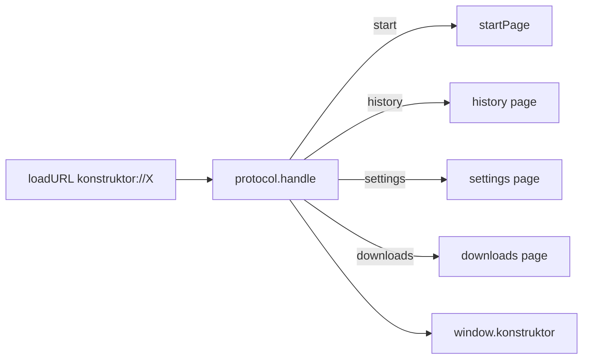

# 🌐 Внутренние страницы

Документ описывает внутренние страницы `konstruktor://`: их адреса и назначение, роутинг запросов, preload-мост и темизацию.

## 🧩 Адреса

Поддерживаются `konstruktor://start`, `history`, `settings`, `downloads`, `extensions`, `permissions` и `ext/<id>/<файл>` для страниц собственных расширений. HTML собирают `build*Page` в `startPage.ts`/`historyPage.ts`/`settingsPage.ts`/`downloadsPage.ts`/`extensionsPage.ts`/`permissionsPage.ts` (общий каркас — `shell.ts`); URL адресов и реэкспорт builders — `internalPages.ts`, единая точка входа для `protocol.ts`, меню и кластеров windows/groups. Файлы расширений читает `protocol.ts` напрямую из каталога расширения (см. [EXTENSIONS.md](../extensions/EXTENSIONS.md)). Страницы без внешних ресурсов — работают офлайн. Каждая страница собирается на запрос с текущим языком: статические строки переводятся `t()`, динамические строки скриптов — встроенным `tr()` по каталогу из `window.__I18N__`, даты — по `window.__I18N_INTL__` (см. [I18N.md](../../shared/i18n/I18N.md)).

| Адрес | Назначение | Хранилище |
|---|---|---|
| `konstruktor://start` | Стартовая страница-табло с плитками | `shortcuts.json` |
| `konstruktor://history` | История визитов с хронологией по дням, месяцам и годам | `history.json`, инкогнито не пишет и не читает |
| `konstruktor://downloads` | Хранилище загрузок с системными иконками | `downloads.json` |
| `konstruktor://settings` | Поиск, домашняя страница, DNS, тема, режимы зума, состав пункта меню, таблица горячих клавиш | `settings.json` |
| `konstruktor://permissions` | Разрешения сайтов: решения по каждому сайту (разрешённые и заблокированные раздельно), снятие одной области, сайта и всех сразу; раздел проверки — над кнопкой общего сброса | `permissions.json` |
| `konstruktor://extensions` | Расширения: установка, тумблеры, предупреждения совместимости | `extensions.json` |
| `konstruktor://ext/<id>/<файл>` | Страницы собственных расширений (только из их каталога) | файлы расширения |

## 🔀 Роутинг

`pages/protocol.ts` регистрирует `protocol.handle` на трех сессиях: default, обычной и инкогнито. Роутинг идет по host URL. Схема объявлена privileged до ready в `index.ts`, иначе view ее не рендерит.

## 🔌 Мост

`internalBridge.ts` ставит `registerPreloadScript` на каждую партицию. Скрипт выполняется в каждом фрейме до загрузки документа и отдает `window.konstruktor`: история, настройки, шорткаты, загрузки, расширения, разрешения сайтов, захват сочетаний (`setHotkeyCapture`).

## 🎨 Темы и поведение

Страницы читают тему из настроек до отрисовки и ставят `dataset.theme`. История группирует визиты по дням, месяцам и годам. Настройки сохраняются через `saveSettings` и пушат `settings:changed` в shell с полем `locale`. Селектор языка в `konstruktor://settings` строится из реестра `LANGUAGES`; после смены языка страница обновляется перезагрузкой вкладки.

Страница настроек содержит таблицу горячих клавиш (`settingsPage.ts`): строки строятся скриптом страницы из запечённого реестра `HOTKEY_ACTIONS`, подписи действий резолвит `hotkeyLabels()` в момент сборки страницы, а не на уровне модуля — иначе `t()` вызвался бы до `initI18n()` и вернул пустые подписи. Строка-дубль подсвечивается красным, строка со снятым сочетанием — оранжевым, дубль показывает модальное окно-предупреждение (`<dialog>`, как на стартовой) и ничего не сбрасывает. Дубли сохранение не блокируют — это осознанное решение пользователя. Пока поле таблицы в фокусе, страница держит захват сочетаний (`setHotkeyCapture`) — см. [TABS.md](../tabs/TABS.md) «Захват сочетаний».
