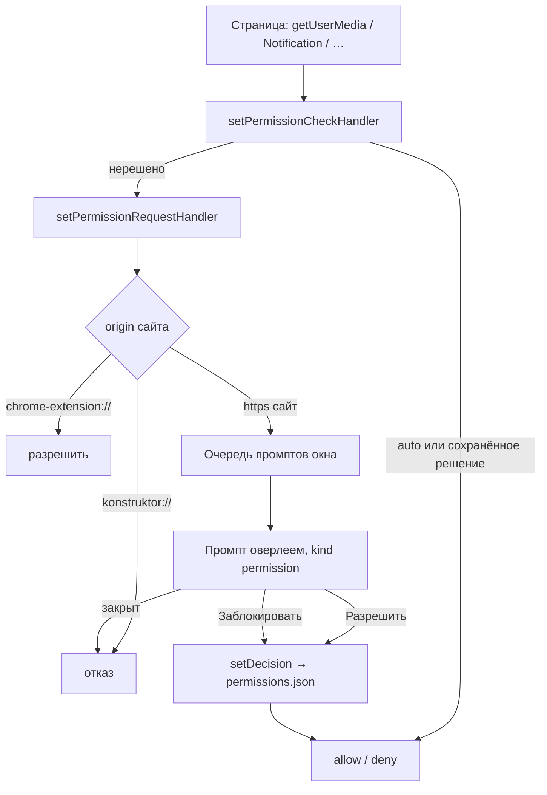

# 🔐 Разрешения веб-страниц

Документ описывает систему разрешений сайтов: какие разрешения браузер спрашивает у пользователя, как устроен промпт, где хранятся решения и что происходит с запросом, когда промпт закрывают.

## 🧭 Таблица решений

Единственный источник правды — `policy.ts` (`classify`). Разрешения делятся на три группы.

| Группа          | Поведение                                               | Разрешения                                                                                                                                                                                                                                      |
| --------------- | ------------------------------------------------------- | ----------------------------------------------------------------------------------------------------------------------------------------------------------------------------------------------------------------------------------------------- |
| Спрашивать      | Промпт с условиями, решение запоминается для origin     | `media` (отдельно микрофон и камера), `geolocation`, `notifications`, `clipboard-read`, `midi`, `midiSysex`, `speaker-selection`, `window-management`, `idle-detection`, `local-fonts`, `sensors`                                               |
| Разрешать сразу | Без промпта: риска нет, а диалог на каждое был бы шумом | `fullscreen`, `automatic-fullscreen`, `pointerLock`, `keyboardLock`, `clipboard-sanitized-write`, `mediaKeySystem`, `persistent-storage`, `screen-wake-lock`, `system-wake-lock`, `captured-surface-control`, `display-capture`                 |
| Запрещать       | Отказ молча, страница получает ошибку                   | `usb`, `hid`, `serial`, `openExternal`, `storage-access`, `top-level-storage-access`, `nfc`, `vr`, `ar`, `smart-card`, `local-fonts` отсутствующие в списке группы, `payment-handler`, `web-printing`, `fileSystem`, `local-network`, `unknown` |

Область решения (`PermissionScope`) — то, что запоминается для origin: `media:audio`, `media:video`, `geolocation`, `notifications`, `clipboard-read`, `display-capture`, `midi`, `midiSysex`, `speaker-selection`, `window-management`, `idle-detection`, `local-fonts`, `sensors`. У `media` областей две: «разрешил микрофон, но не камеру» — рабочее состояние, как в Chrome.

`display-capture` вынесено в «разрешать сразу» намеренно: согласие спрашивает обработчик `getDisplayMedia`, и промпт разрешения дал бы два диалога на одно действие (см. ниже).

## 🔄 Поток запроса

Chromium делает **проверку** разрешения, и только если она отказала — **запрос**. Оба обработчика обязательны: без проверки врёт `navigator.permissions.query`, без запроса негде показать промпт.

Проверка отвечает **по сохранённому решению и синхронно**: нерешённое разрешение отдаёт `false`, и тогда Chromium идёт в обработчик запроса. Ответь проверка «да» — Chromium счёл бы разрешение выданным, и промпт не показался бы никогда. Обработчик запроса тоже отвечает без ожидания: нерешённые области уходят в очередь промптов, а `callback` вызывается уже с ответом пользователя.

Если часть областей решена, а часть нет, спрашивают только нерешённые: сохранённый `block` по любой из запрошенных областей закрывает запрос сразу.

## 🪟 Промпт

Промпт — вид оверлея `permission` (`renderer/overlay/PermissionPrompt.vue`), точка вызова — левый нижний угол адресной строки. Положение панели знает только shell (пресеты `ClassicTop` и `Minimal` кладут её по-разному), поэтому `AddressBar.vue` присылает угол каналом `permissions:anchor`, а main хранит его в `WindowState.permissionAnchor`. Если значения ещё нет, берётся левый верхний угол области страницы.

Выбор уходит существующим каналом `overlay:submit` строкой `id::1` (`allow::1` — разрешить и запомнить). Отдельного канала вид не заводит.

Поверхность у окна одна, поэтому промпты выстраиваются в очередь на окно: показывается первый, чья вкладка активна и чей запрос пришёл раньше. Остальные ждут.

**Закрытие промпта — это отказ.** Escape, клик по подложке, уход из приложения (Alt+Tab), вытеснение другим оверлеем (меню), прерванный показ, навигация вкладки, закрытие вкладки — во всех случаях обработчик разрешения получает `callback(false)`. Обратного пути нет: страница уже ждёт `getUserMedia`, и не ответить значит повесить её навсегда. Событие о снятии поверхности приходит из оверлея через слушатель `setOverlayEndedListener` (`overlay/close.ts`).

**Смена вкладки — не отказ.** Промпт скрывается и возвращается, когда пользователь возвращается на ту же вкладку: решение ещё не принято, и терять его нельзя. Метку ставит `handleTabChange` (`windows/deps.ts`, до фактического переключения), а показ повторяет `pumpPrompts` после него.

## 💾 Хранение решений

Решения лежат в `permissions.json` (`permissionsStore.ts`) как `origin → область → allow/block`. Чтение синхронное: обработчик проверки обязан ответить без `await`. Кэш прогревается до первого окна, а запись обновляет кэш до файла — следующая проверка того же разрешения видит решение сразу.

Приватные окна решений не помнят: их карта живёт только в памяти процесса. Чекбокс «запомнить» в промпте приватного окна не показывается — сохранять там нечего.

Видно решения в двух местах:

- **кнопка-бейдж ✅ в адресной строке** — одна кнопка на всё, что сайт получил и что прямо сейчас использует. К ✅ добавляются значки живого захвата: 📷 камера, 🎤 микрофон, 🖥️ экран. При активном захвате у кнопки появляется рамка акцента, и подсказка меняется на «Сайт использует камеру, микрофон или экран». Кнопка показывается, если у сайта есть решения или идёт захват. Клик открывает меню: решения подзаголовками «✅ Разрешено» и «⛔ Заблокировано», у каждой строки справа отдельная квадратная кнопка 🗑️ — снять это разрешение, не уходя со страницы; ниже пункт «Сбросить все разрешения этого сайта» с той же корзиной (снять решения сайта целиком) и переход на страницу разрешений;
- **страница `konstruktor://permissions`** — все сайты с решениями. Внутри сайта записи разделены по статусу: подзаголовок «✅ Разрешено:» со списком областей, затем «⛔ Заблокировано:». Снятие решения есть на трёх уровнях: у каждой области (отдельная квадратная кнопка 🗑️ в строке), у сайта целиком (такая же в его заголовке) и сразу у всех сайтов. Снятие одной области не трогает остальные решения сайта — сама область снова начинает спрашивать, и её решение пропадает из бейджа. Здесь же раздел «Проверить разрешения» со ссылкой на `permission.site` — внешний сайт, на котором видно, какие запросы браузер действительно показывает. Раздел стоит ВЫШЕ кнопки «Сбросить все разрешения сайтов»: сначала проверка, потом уже необратимая чистка списка. Из настроек ведёт только кнопка «Открыть разрешения сайтов»: список растёт с числом сайтов, и в общем потоке настроек он хоронил бы тему и горячие клавиши.

**Снять решение можно прямо в меню бейджа**: у каждой строки области справа стоит отдельная квадратная кнопка 🗑️ — та же корзина, что и на странице разрешений. Она снимает решение только этой области и не уводит со страницы. Схема одна на оба места: НАЗВАНИЕ — просто текст, ДЕЙСТВИЕ — отдельная кнопка сбоку. Пока кнопкой была сама строка, корзина оказывалась вложенной в кнопку — и по разметке (вложенный `button` невалиден), и на вид («кнопка в кнопке»), поэтому строка помечена `plain` и не нажимается мышью (см. [OVERLAY_UI.md](../../renderer/overlay/OVERLAY_UI.md)). С клавиатуры строка достижима: стрелки на неё встают, Enter делает то же, что корзина. Подзаголовки при этом неактивны — они пропускаются и клавиатурной навигацией, то есть ведут себя как заголовки, а не как пункты. Неактивность — только в ПОВЕДЕНИИ: цвет и размер у них как у обычного пункта (`MenuItem.heading`), потому что заголовок делит список, а серый цвет недоступного пункта на тёмной теме делал его наименее читаемой строкой меню. Кнопка-корзина — квадрат 26×26 в меню и 28×28 на странице, рамка видна всегда: одинаковые действия выглядят одинаково.

## 🎥 Индикатор захвата

Electron не сообщает о начале и конце захвата медиа, поэтому о нём узнаёт сама страница: main кладёт в её **главный мир** скрипт (`captureIndicator.ts`, `CAPTURE_HOOK_SOURCE`), который оборачивает `getUserMedia` и `getDisplayMedia` и сообщает о появлении и остановке треков. Сообщение идёт `window.postMessage` в изолированный мир прелоада страницы, оттуда — каналом `permissions:capture` в main, где ложится в запись вкладки и уходит в `tabs:state`. Кнопка-бейдж ✅ в адресной строке добавляет к себе 📷/🎤/🖥️, пока треки живы.

Скрипт ставится на каждой навигации (`dom-ready` в `tabsManager`), только для `http(s)`. Граница доверия: страница может подделать сообщение и показать ложный индикатор. Риск принят — индикатор ничего не разрешает и не запрещает, а защита от подделки потребовала бы канала, которого у главного мира нет.

## 🖥️ Захват экрана

`getDisplayMedia` обслуживает `setDisplayMediaRequestHandler`: он показывает тот же промпт (область `display-capture`) и при согласии отдаёт **первый экран** из `desktopCapturer.getSources`. Выбора окна или вкладки нет: согласие одно на все источники — захват отдаётся целым экраном. Выбор источника — в [плане](../../../docs/plans/PERMISSIONS_PLAN.md).

## 🔌 Что не поддерживается

Отказаны целиком и молча (страница получает ошибку доступа): устройства (`usb`, `hid`, `serial`), `storage-access`, `local-network`, `fileSystem`, `nfc`, `vr`, `ar`, `web-printing`, `payment-handler`, `web-app-installation` и всё неизвестное. Отказ выбран потому, что он объясним, а выданный доступ к устройству или файловой системе отозвать нечем: обработчиков выбора устройства и слежения за отзывом нет. Устройства и остальные случаи разобраны в [плане](../../../docs/plans/PERMISSIONS_PLAN.md).

## 🛠️ Проблемы и решения

### 🚪 Вытеснение промпта другим оверлеем

Вложенность уровней оверлея выключена (`NESTED_DIALOGS = false` в `overlay/service.ts`), новая поверхность снимает прежнюю через `clearSession` — без единого колбэка. Промпт, вытесненный меню, оставался бы висеть в ожидании, а страница — ждать `getUserMedia` вечно. Поэтому `close.ts` получил слушатель `setOverlayEndedListener`, а уведомление о снятии отправляют все точки закрытия: `closeOverlay` (глубина 1), `closeStack`, `abortPresent` и ветка вытеснения в `showOverlay`.

В ветке вытеснения уведомление идёт **после** `setSession` новой сессии: если отправить его раньше, очередь тут же показала бы следующий промпт, и он вложился бы в чужой показ — в стеке оказались бы два уровня.

### 🕵️ Сокрытие промпта при переключении вкладки

`closeOverlayOnTabChange` закрывает стек при каждой смене активной вкладки. Отличить «пользователь ушёл на другую вкладку» от «пользователь закрыл промпт» по одному лишь факту закрытия нельзя, поэтому метка `hidden` ставится заранее — в `handleTabChange` из `deps.setActiveTab`, пока `ws.activeTabId` ещё указывает на прежнюю вкладку. Скрытый промпт остаётся в очереди, и `pumpPrompts` показывает его снова, когда вкладка становится активной.

### 🔒 Внутренние страницы и расширения

`konstruktor://` — не сайт, разрешения ей не выдаются: обработчики отказывают до всякой очереди. Страницы расширений (`chrome-extension://`) получают разрешения без промпта: расширение уже установлено пользователем, и спрашивать про каждый его запрос значило бы спрашивать дважды.

### 🧪 Проверка

Цепочка проверяется автопрогоном: `KONSTRUKTOR_PERM_SMOKE=http://localhost:5173/ npm run dev` (при поднятом Vite-сервере) открывает страницу, просит микрофон, нажимает «Разрешить» и просит снова. В логе видно показ промпта (`permission prompt shown`), запись решения (`permission decision`), результат обоих запросов (`GRANTED`), содержимое `permissions.json` и текст страницы разрешений. Подробности — в [DIAGNOSTICS.md](../docs/DIAGNOSTICS.md).
