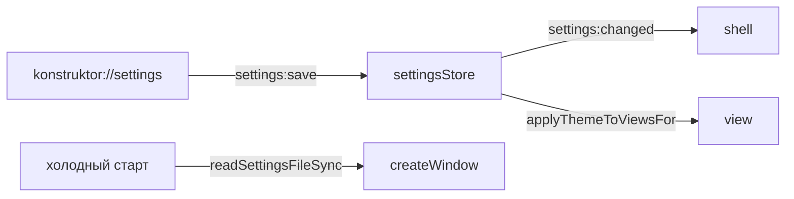

# 💾 Хранилища

Документ описывает JSON-хранилища main и Secure DNS: раскладку файлов по рабочим пространствам, кэши, поведение инкогнито.

## 🧩 Файлы

Все изменяемые данные браузера лежат в каталоге рабочего пространства `userData/workspaces/<wsId>/`: настройки в `settings.json`, история в `history.json`, загрузки в `downloads.json`, плитки в `shortcuts.json`, закладки в `bookmarks.json`, группы в `groups.json`, слепок окон в `windows.json`, недавно закрытые вкладки и окна в `closed.json`, решения по разрешениям сайтов — в `permissions.json`, установленные расширения — в `extensions.json` и каталоге `extensions/`, сессии запуска — в `sessions.json` и маркере `session.lock`. Общими для приложения остаются `workspaces.json` (реестр пространств) и `settings-global.json` (только DNS).

Пути собирает `workspaces/paths.ts` — сторы не склеивают их сами. Запись идёт через `workspaces/atomic.ts`: временный файл и `rename`, чтобы оборванная запись не оставила половину файла. Каждый store держит кэш в памяти **по пространствам** и пишет через debounce или по событию. Каналы `history:*` / `downloads:*` / `settings:*` / `shortcuts:*` / `bookmarks:*` сводит `ipc.ts`, каналы `permissions:*` — `permissions/ipc.ts`.

Раскладку, миграцию старого профиля, реестр, страницу управления и правила копирования конфигурации описывает [WORKSPACES.md](../workspaces/WORKSPACES.md).

Помимо файлов пространство владеет двумя партициями Chromium: обычной и приватной. Их выбор — `workspaces/electronSession.ts`; cookies, localStorage и кэш сайтов в файловое хранилище не попадают и не смешиваются с данными другого пространства.

## ⚙️ Настройки

`settingsStore.ts` хранит поисковик, homepage, devtools, DNS, язык интерфейса (`locale`: `auto` | код из реестра LANGUAGES, дефолт `auto` — резолв и смена описаны в [I18N.md](../../shared/i18n/I18N.md)), анимации, тему, скругление, fullscreen, `rememberBounds`, `rememberTabs`, режим зума (`zoomMode`: origin/tab) и единый зум (`zoomSync`), видимость частей пункта меню (`menuShowIcons`, `menuShowText`, `menuShowHotkeys`, `menuHotkeysOnHover`), переопределения горячих клавиш (`hotkeys`: разреженная карта «действие -> акселератор», см. [TABS.md](../tabs/TABS.md) «Горячие клавиши»), геометрию и сессию вкладок.

Настройки разделены на два файла, и это разделение не косметическое:

| Файл | Поля | Причина |
|---|---|---|
| `settings-global.json` | `dnsMode`, `dnsCustom` | DNS ставится switches'ами в командную строку до `ready` и действует на процесс целиком — разделить его по пространствам нельзя технически |
| `workspaces/<wsId>/settings.json` | всё остальное | Пространств может быть открыто несколько, и тема, поисковик, зум у каждого свои |

Вызывающий код видит одну плоскую структуру: `getSettings(wsId)` и `getSettingsSync(wsId)` накладывают общие поля поверх настроек пространства, а `saveSettings(patch, wsId)` сам раскладывает патч по двум файлам. Аргумент `wsId` по умолчанию — пространство запуска (`bootWorkspaceId()`).

Язык интерфейса (`locale`) — настройка **пространства**, а не процесса: переводчик умеет отдавать функцию перевода на заданный язык (`getFixedT`), поэтому меню, страницы и диалоги собираются в языке своего пространства, даже когда открыто несколько окон с разными языками (см. [I18N.md](../../shared/i18n/I18N.md)).

`ensureGlobalSettingsSync` при старте (до первого окна) переносит `locale` из старого общего файла в `settings.json` каждого пространства, где языка ещё нет, и удаляет поле из общего файла: до этапа 8 язык был один на процесс, и без переноса выбранный вручную язык сменился бы на системный.

Инвариант «включена хотя бы одна идентифицирующая часть — иконка или текст» держит `normalizeMenuParts` внутри `saveSettings`/`saveSettingsSync`: если иконка и текст выключены разом, возвращается текст. Хоткей в инвариант НЕ входит — он не идентифицирует пункт, а лишь подсказывает сочетание клавиш, поэтому его можно выключать в любом сочетании. Проверка в хранилище, а не только в форме, потому что значение меняют и другие входы (`settings:save`), и молча сохранённый безымянный пункт неотличим от разделителя.

Сочетания горячих клавиш отбирает `normalizeHotkeys` (там же, в `saveSettings`/`saveSettingsSync`): неизвестные действия, нераспознаваемые сочетания, одиночные печатные клавиши без модификатора и дубликаты отбрасываются — действие остаётся на значении по умолчанию. Пустая строка — не мусор, а состояние «сочетание снято» (Backspace в таблице настроек): ключ остаётся с пустым значением, и действие перестаёт перехватывать клавишу. Отсутствие ключа отличается от пустого значения: там действует дефолт. Доверять форме настроек нельзя: тот же `settings:save` доступен из любого окна.

Чтение идет через `getSettings`, синхронное через `getSettingsSync`; запись — `saveSettings`, синхронная запись — `saveSettingsSync` (её требует хук `close` окна: асинхронный `writeFile` не доживает до выхода процесса).

## 🕘 История, закладки и загрузки

`historyStore.ts` пишет визиты и метаданные, отдает ленту через `getTimeline`. `downloadsStore.ts` ведет прогресс через `will-download`. `bookmarksStore.ts` держит закладки панели: тоггл по URL и снятие одной записи. `closedStore.ts` ведёт журнал недавно закрытых вкладок и окон: фрагменты слепка и подпись для меню, запись забирается при возврате (см. [TABS.md](../tabs/TABS.md) «Недавно закрытые»). Инкогнито историю не пишет и не читает, загрузки читает общие.

Закладки раньше жили в `localStorage` шелла, а шелл работает в in-memory партиции — они не переживали перезапуск. Перенос в `bookmarks.json` пространства обязателен: без него изоляция данных была бы фиктивной.

## 🔐 Разрешения сайтов

`permissions/permissionsStore.ts` пишет решения по разрешениям как `origin → область → allow/block` и отдаёт их синхронно из кэша: обработчики разрешений Chromium обязаны ответить до конца тика, и `getDecision` без `await`. Кэш прогревается при старте (`initPermissions`), запись обновляет его ДО файла — иначе повторная проверка того же разрешения не увидела бы только что выданное решение.

Приватные окна решений не помнят: их карта живёт в модуле (`ephemeral`) и никогда не попадает в `permissions.json`. Подробности — в [`permissions/PERMISSIONS.md`](../permissions/PERMISSIONS.md).

## 🔐 Secure DNS

`dnsConfig.ts` маппит режим в DoH-сервер через `dnsServersFor` и ставит switches через `applySecureDns`. Применение идет при старте из сохраненных настроек, смена в UI требует рестарта.

## 🛠️ Проблемы и решения

### 📜 История без дублей

`page-title-updated`/`page-favicon-updated` — только `updateMetadata`, новый визит не засчитывать, иначе один заход = ×2 в истории.

### 💾 Кэш настроек пуст на старте

`getSettingsSync()` на пустом кэше читает файл с диска, а не отдаёт дефолты: геометрия и сессия первого окна берутся синхронно, иначе окно стартует не с тех bounds, а зум — не с того процента. Кэш наполняется первым же чтением и остаётся живым до конца процесса.
