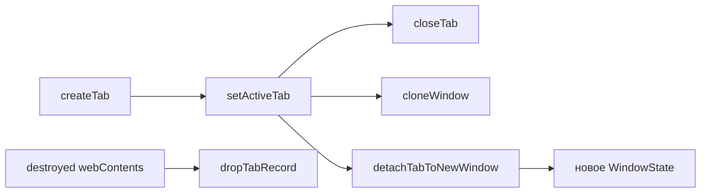
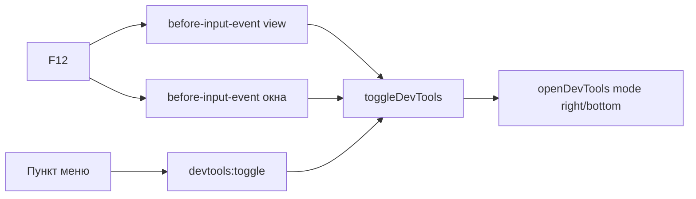

# 📂 Вкладки

Документ описывает вкладки браузера: состояние и жизненный цикл, панель вкладок, перетаскивание, контекстные меню и DevTools страницы. Система групп вкладок вынесена в [GROUPS.md](../groups/GROUPS.md).

## 📐 Архитектура

Вкладка — `WebContentsView` внутри окна, а не webContents самого окна. Вкладки и панель живут в `tabs/`: `tabsManager.ts` (`createTab`, `setActiveTab`, `closeTab`, `cloneWindow`, `detachTabToNewWindow`, `pushTabsState`), порядок ряда — в `stripOrder.ts`, меню вкладки и панели — в `tabsMenu.ts`, контекстное меню страницы — в `pageMenu.ts`, DevTools — в `devtools.ts`, каналы `tabs:*`/`devtools:*`/`layout:update` — в `tabsIpc.ts`. Шаблоны групп — в `groups/groupsStore.ts`, экземпляры — в `groups/groupsInstances.ts`, меню групп — в `groups/groupsMenu.ts`. Типы `TabData` и пул окон лежат в `windows/browserState.ts`, поиск вкладки — `findTab`, окно-родитель — `parentOfTab`.



Вкладка может закрыться **сама**: страница вызывает `window.close()` — так делают служебные страницы расширений (например `ask.html` у Tampermonkey), — и Chromium уничтожает её `webContents` в обход `closeTab`. Раньше запись оставалась в `ws.tabs` и `tabOrder`: «призрак» висел в ряду, а `pushTabsState` падал в главном процессе исключением `Cannot read properties of undefined (reading 'id')` (замер: одна и та же вкладка `ask.html` в 29 пушах). Поэтому `createTab` подписывается на `destroyed` у `webContents` вкладки и убирает запись через `dropTabRecord` — уборка **без** обращения к view (её уже нет), в отличие от `closeTab`, который сначала закрывает view, а потом вызывает ту же уборку. Защита в `pushTabsState` (пропуск записи без `webContents`) оставлена как страховка: пропустить дешевле, чем уронить процесс диалогом.

## 📋 Панель вкладок

Порядок панели задают `stripOrder` и `pinnedStripOrder` (`stripOrder.ts` — `ensureStripToken`, `removeStripToken`, `moveStripToken`, `reorderStrip`, `rebuildStripFromTabs`; инвариант проверяет `checkStripInvariant`). Токены двух сортов: `t:<id>` для вкладок и `g:<instanceId>` для корневых групп — одного ранга, чередуются свободно.

Вложенные группы (`parentInstanceId`) в ряд не входят, рисуются внутри родителя. Вкладка без группы лежит в `stripOrder`; вкладка внутри группы токена не имеет. `createTab` кладёт токен вкладки, уход вкладки в группу его убирает, создание и открытие группы кладут токен группы. Нарушение инварианта даёт невидимую группу или дубль в ряду.

`tabs:reorder` принимает токены единого ряда и синхронизирует `tabOrder` по нему.

### 📎 Minimize

Пункт меню `Minimize` ставит флаг `pinned` без перемещения вкладки: свернутая вкладка схлопывается до иконки и остается на своем месте в общем ряду. Отдельной закрепленной зоны для вкладок нет, `pinnedStripOrder` хранит только закрепленные группы.

### 🖱️ Меню панели

ПКМ по свободному месту панели, включая кнопку «+», открывает меню панели (`tabs:strip-context-menu`): **Новая вкладка, Новая группа, Закрыть все вкладки**. Последний пункт закрывает все вкладки окна по копии `tabOrder` — `closeTab` мутирует порядок.

## ⌨️ Горячие клавиши

Действия браузера с сочетаниями задаёт реестр `shared/hotkey-actions.ts` (`HOTKEY_ACTIONS`, `DEFAULT_HOTKEYS`): **Обновить вкладку, Закрыть вкладку, Новая вкладка, Вернуть закрытую вкладку, Поиск на странице, Инструменты разработчика, Полноэкранный режим**. Акселераторы по умолчанию — `CmdOrCtrl+R/W/T/Shift+T/F`, `F12`, `F11`.

Сочетания **переназначаются** пользователем в настройках (`konstruktor://settings`, секция «Горячие клавиши»): таблица «действие — сочетание» плюс кнопка сброса к значениям по умолчанию. Подписи действий резолвятся при сборке страницы (`hotkeyLabels()` в `settingsPage.ts`) — `t()` работает только после `initI18n()`, см. [TROUBLESHOOTING.md](../../../docs/TROUBLESHOOTING.md). Backspace/Delete в поле снимает сочетание: пустое значение — это «не назначено», а не дефолт. Ввод дубля ничего не сбрасывает и сохранение не блокирует: пользователь получает модальное предупреждение с именем конфликтующего действия, строка-дубль подсвечена красным, снятая — оранжевым. Переопределения лежат в `settings.json` полем `hotkeys` (разреженная карта «действие -> акселератор»; пустая строка = сочетание снято), отбор допустимых значений — `normalizeHotkeys` в `settingsStore.ts` (см. [STORES.md](../store/STORES.md)).

Разрешение и сопоставление — `main/hotkeys.ts`: `resolvedHotkeys()` накладывает настройки на дефолты (пустое значение остаётся пустым — действие не перехватывает клавишу), `matchHotkey(input)` находит действие по вводу, `hotkeyLabel(id)` даёт подпись для меню (для снятого сочетания — пусто, подпись не рисуется). Разбор сочетаний — чистые `parseAccelerator`/`matchesInput` в `shared/hotkeys.ts`, поэтому тем же реестром пользуется и shell (дубль в `App.vue`, см. [CORE_STATE.md](../../renderer/core/CORE_STATE.md)).

Точек входа в main две, как было у Ctrl+F/F11/F12: `before-input-event` view (`tabsManager.ts`) и окна (`windowsManager.ts`, см. [WINDOWS.md](../windows/WINDOWS.md)). Обе обязательны — событие стреляет только в focused webContents. Порядок разбора: свои действия -> масштаб -> команды расширений (расширение не может отобрать сочетание браузера). Разбор по `input.code` (физическая клавиша), `shift`/`alt` — точные: `Ctrl+Shift+R` не срабатывает как обычная перезагрузка.

Масштаб страницы (`Ctrl/Cmd + = / - / 0`) в таблицу не входит: это семейство из трёх сочетаний с допуском `shift` (на части раскладок `+` — это Shift+Equal), и оно остаётся фиксированным (см. [ZOOM.md](../docs/ZOOM.md)).

Подпись сочетания в пункте меню (`MenuItem.hotkey`) строит `hotkeyLabel(id)` по действующему значению, поэтому переназначенное сочетание сразу видно в меню.

## 🕘 Недавно закрытые

Журнал закрытий ведёт `store/closedStore.ts` в файле `closed.json` пространства: последние 25 записей, новые первыми. Запись хранит не runtime-идентификаторы, а фрагмент слепка окна (`SnapshotWindow`), тот же формат, по которому восстанавливаются окна при старте — отсюда бесплатно берутся заголовок, иконка, закрепление и активная вкладка.

Пишутся только пользовательские закрытия:

- вкладка — в `closeTab` (`recordClosedTab`); служебные `konstruktor://start` и `about:blank` пропускаются, иначе они вытесняли бы настоящие вкладки;
- окно — в хуке `close`, целиком и только когда в пространстве остаются другие окна: закрытие последнего — это выход из браузера, и окно и так вернётся по слепку при следующем старте.

Переключение в инкогнито, выход из приложения и detach вкладки в журнал не попадают: они закрывают view напрямую, без `closeTab`. Инкогнито-журнала нет вовсе.

Возврат — `reopenClosed` в `windows/deps.ts`. Вкладка встаёт в ИСХОДНОЕ окно, если оно ещё живо: запись хранит ключ окна (`w<N>`), который стабилен между запусками. Живого окна нет — вкладка открывается в текущем. Окно восстанавливается целиком из своего слепка, тем же путём, что при старте. Запись забирается из журнала при возврате: иначе хоткей открывал бы одну и ту же вкладку бесконечно.

Список виден в боковой панели пункта «История» меню браузера — см. [OVERLAY_UI.md](../../renderer/overlay/OVERLAY_UI.md) «Боковая панель подпунктов».

### 🎯 Захват сочетаний: ввод в таблице настроек

Пока поле таблицы горячих клавиш в фокусе, браузерные сочетания **молчат**: иначе Ctrl+W закрыл бы вкладку настроек прямо в момент ввода, а Ctrl+R перезагрузил бы её — сочетание не удалось бы набрать. Страница зовёт `window.konstruktor.setHotkeyCapture(true/false)` (канал `hotkeys:capture` → `setHotkeyCapture`, `main/hotkeys.ts`), обе точки входа в начале обработчика спрашивают `isHotkeyCapture(wc)` и бездействуют, отдавая событие странице.

Два условия, на которых держится механизм:

- **Никакого `preventDefault` в режиме захвата.** Он погасил бы и `keydown` поля — нажатие просто не дошло бы до страницы. Акселераторы дефолтного меню Electron гасит `setIgnoreMenuShortcuts(true)`, который ставится вместе с флагом (см. [TROUBLESHOOTING.md](../../../docs/TROUBLESHOOTING.md) «preventDefault в before-input-event»).
- **Флаг помимо набора требует фокуса webContents** (`isFocused()`): потеря фокуса на уровне окна не гарантирует DOM-событие `blur` на поле, а залипший захват оставил бы браузер без горячих клавиш. Страница дополнительно снимает флаг на `focusout` из таблицы (по `relatedTarget` — переход по Tab между полями захват не теряет) и на `pagehide`, main — на `destroyed` webContents.

Проверка: фокус в поле сочетания → Ctrl+W/Ctrl+T/Ctrl+R/F11 не срабатывают, а нажатие попадает в поле; клик мимо таблицы → сочетания снова работают.

## 🗂️ Группы вкладок

Шаблон группы живет в `groups.json` (`groupsStore.ts`), открытые экземпляры — в `groupsInstances.ts`. Вкладка ссылаетеея на экземпляр через `groupId`, группа хранит `urls` и `children` — вложенность без циклов. Детали системы — в [GROUPS.md](../groups/GROUPS.md).

Один шаблон открывается несколько раз, у каждого открытия свой `instanceId`, вложенность открытых экземпляров — через `parentInstanceId`. Пустой экземпляр исчезает с панели вкладок, минимальная группа содержит одну вкладку. Закрепление на панели закладок — флаг `pinned`: незакрепленная группа живет только на панели вкладок, пока открыта.

Мутации шаблонов рассылаются через `groups:changed` моментально, без ожидания `tabs:state`. Меню заголовка группы: создать группу, переименовать, цвет, иконка, вложить в другую группу, закрепить на закладках, закрыть вкладки, разгруппировать, перенести вкладки в другую группу, удалить.

## 🔗 Открытие ссылок

`setWindowOpenHandler` на view перехватывает `window.open` и клики по `target="_blank"`. Http/https и `konstruktor://` открывает вкладкой в том же окне через `createTab` — системный браузер не участвует. Не-http схемы (`mailto:`, `tel:`) уходят в `shell.openExternal`: в вкладку их не загрузить.

## 🖱️ Контекстные меню страницы

ПКМ по сайту (и Shift+F10) открывает overlay-меню `kind: 'menu'` — системный `Menu.popup` проект не использует. Хук `context-menu` висит на `view.webContents` в `createTab` (`tabs/tabsManager.ts`), пункты и действия — в `tabs/pageMenu.ts` (`buildPageMenu` + `showPageContextMenu`), действия «открыть вкладкой/окном» и инспектор собирает `windows/deps.ts` (`pageMenuDeps`).

```mermaid
flowchart LR
  View[view.webContents<br/>context-menu] --> PM[pageMenu.ts]
  PM -->|buildPageMenu| Items[OverlayMenuItem[]]
  PM -->|showOverlay kind: menu| OV[overlay-окно]
  OV -->|onSelect| Act[действия в main]
  Act --> WC[webContents<br/>clipboard, download, навигация]
```

Приоритет контекста — цепочка Chrome: `isEditable` → `linkURL` → `mediaType === 'image'` → `selectionText` → страница. Пункт не показывается, если контекст его не даёт: редактируемые поля меню не получают (Cut/Copy/Paste через `editFlags` — вторая фаза), внутренние страницы `konstruktor://` отсекаются до показа.

| Контекст | Пункты |
|---|---|
| Страница | Back (disabled без истории), Forward, Reload, Save page as, Print |
| Изображение | Open image in new tab/new window, Save image as, Copy image address |
| Выделение | Copy |
| Ссылка | Open link in new tab/new window, Save link as, Copy link address, Copy link text |

Общий хвост добавляется один раз: разделитель, `Search`, View page source, Inspect. Подпись поиска — без пояснений: ни названия движка, ни текста запроса в пункте нет. Аргумент поиска: выделение → текст ссылки → URL страницы; пробелы нормализуются, но текст не обрезается — иначе обрезка уходила в сам запрос. Движок и `%s` берутся из `searchEngine` (`getSettingsSync()`) в момент выбора, то есть поиск идёт движком браузера из настроек (меню своего движка не имеет), запрос открывается в той же вкладке. Пункты «открыть вкладкой/окном» показываются только для схем `http`, `https`, `konstruktor`, `file` — `javascript:` и прочие скрываются при сборке. `Save link as` и `Save image as` уходят в `downloadURL` → тот же конвейер `will-download` (downloads.json и тост), `Save page as` — `dialog.showSaveDialog` + `savePage(path, 'HTMLComplete')` со своим тостом, `Print` — `wc.print()`, `Inspect` — `inspectElementAt` (`tabs/devtools.ts`): `toggleDevTools`, если панель закрыта, затем `inspectElement(x, y)`.

Состояние перечитывается в момент показа и в момент действия через `findTab(tabId)`: замыкание хука хранит только id, а `tabs:attach`/`detach` переносят view между окнами — ид вкладки стабилен при переезде, ws — нет.

Якорь — `view.getBounds() + params.{x, y}` в координатах content-области окна, кламп в `workArea` уже в `overlay/geometry.ts`. `params.x/y` приходят в DIP viewport вызвавшего вида и не меняются при зуме (проверено на 80/100/150%), при прокрутке и из iframe — координаты считаются от основного вида даже для сабфрейма. Клавиатурный вызов приходит тем же событием `context-menu` с `menuSourceType: 'keyboard'`.

Ограничение: один оверлей на родителя — ПКМ по странице при открытой панели поиска закрывает панель поиска. Согласовано с инвариантом системы, стек меню поверх поиска — вторая фаза.

Подписи пунктов — ключи `pageMenu.*` (`src/shared/i18n/locales/*.json`), поэтому меню следует за языком интерфейса: `t()` синхронен после `initI18n()` и собирается в момент показа, как у `getSettingsSync()`.

## 🔧 DevTools страницы

F12 открывает Chrome DevTools для открытой веб-страницы — то есть для `WebContentsView` вкладки, а не для интерфейса браузера. Логика в `devtools.ts` (`toggleDevTools`, `closeDevToolsFor`, `devToolsStateOf`), точки входа: `before-input-event` view, `before-input-event` окна, `devtools:toggle`, пункт меню браузера.



Точки входа дублируются намеренно: `before-input-event` стреляет только в том `webContents`, который сейчас в фокусе, поэтому F12 из адресной строки или панели вкладок без обработчика окна не сработал бы. В фокусе самого DevTools Chromium обрабатывает F12 сам — там событие не доходит, закрывает панель штатно.

Определяющий факт реализации: `WebContentsView` в Electron — обёртка над `InspectableWebContentsView`, где уже есть пара «страница + DevTools» и разметка дока с разделителем и ресайзом. Док-нутые DevTools рисует Chromium сам, деля bounds view между контентом и панелью, поэтому `layoutView` в layout не вмешивается. Побочный эффект тот же, что и у обычного дока: при пересчёте `setBounds` содержимое страницы сужается вместе с панелью.

`setDevToolsWebContents` не используется — он переводит DevTools в `detach` с отдельным системным окном, а докнуть панель в собственный `BrowserWindow` или оверлей-окно нельзя: там нет `InspectableWebContentsView`, который Chromium ждёт для разметки дока.

Сторона дока на первом открытии выбирается по геометрии view: узкое окно (меньше 480 px) или высокое (высота больше 3/4 ширины) — док вниз, иначе вправо, как в Chrome. Дальше Chromium переключает док сам при ресайзе. Режимы `detach` и `undocked` не используются: это отдельное окно поверх окна, другой UX.

Состояние лежит в `TabData.devTools` и в `TabRecord.devToolsOpen`. Оно принадлежит конкретной вкладке, поэтому смена активной вкладки панель не закрывает — она остаётся открытой на своей вкладке. `pushTabsState` берёт признак не из записи, а опросом `isDevToolsOpened()`: панель закрывается не только через F12, но и крестиком в самом DevTools, и запись без такой подстраховки протухала бы. Подписки `devtools-opened` и `devtools-closed` в `createTab` держат запись в синхроне. Закрытие панели при закрытии вкладки и при переключении инкогнито делает `closeDevToolsFor` — до уничтожения `webContents`, иначе состояние уходит вместе с view молча.

## 🛠️ Проблемы и решения

### 📎 Minimize

Пункт меню `Minimize` ставит флаг `pinned` без перемещения вкладки: свернутая вкладка схлопывается до иконки и остается на своем месте в общем ряду. Отдельной закрепленной зоны для вкладок нет, `pinnedStripOrder` хранит только закрепленные группы.

### 🕵️ Detach до did-finish-load

Новое окно при detach создавать первым и класть вкладку в `tabOrder` сразу: иначе `did-finish-load` создаст лишнюю стартовую, а `pushTabsState` уйдет в пустоту.

### 🐞 GitHub и дефолтный UA

Часть CDN отдает `ERR_CONNECTION_CLOSED` на дефолтном UA Electron: повтор с Chrome-UA чинит handshake (`did-fail-load` в `tabsManager.ts`).

### ⌨️ Дефолтное меню Electron перехватывает Ctrl+R

Приложение не зовёт `setApplicationMenu(null)`, поэтому у него живо меню Electron по умолчанию, а в нём **Ctrl+R** назначен пункту «Reload», **Ctrl+W** — «Close», F11 — «Toggle Full Screen». Эти акселераторы обрабатывает сам Electron, и без вмешательства Ctrl+R перезагружал бы не вкладку, а `webContents` в фокусе (а из адресной строки — весь shell).

Проверка: `electron` на временном главном скрипте выводит `Menu.getApplicationMenu()` — там три секции (View/Window/…) с этими акселераторами.

Лечение уже встроено: `before-input-event` вызывается **до** акселераторов меню, и `e.preventDefault()` гасит и их. Поэтому свои Ctrl+R/W/T достаточно разобрать в `before-input-event` и не отменять само меню: `setApplicationMenu(null)` не нужен, а он заодно убрал бы системные сочетания копирования/вставки в полях.

Обратная сторона: `preventDefault` не годится там, где нажатие должно дойти до страницы — в режиме захвата сочетаний (таблица настроек) акселераторы гасит `setIgnoreMenuShortcuts(true)` на время фокуса поля.
