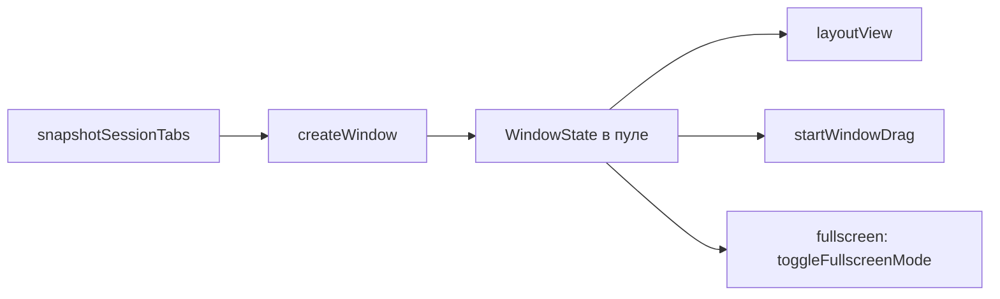

# 🖥️ Окна

Документ описывает окна браузера: состояние и пул, создание и жизненный цикл, меню окна, перетаскивание, layout, сессии, fullscreen, инкогнито.

## 📐 Архитектура

`browserState.ts` хранит типы `WindowState` и `TabData`, пул `windows`, поиск вкладки — `findTab`, окно-родитель — `parentOfTab`, id выдает `allocTabId`.

Окно принадлежит рабочему пространству: `WindowState.workspaceId` задаёт каталог данных, партиции вкладок и реестр расширений, а `WindowState.key` (`w1`, `w2`, …) — стабильный ключ окна внутри пространства, по которому слепок окон переживает перезапуск. Окна разных пространств живут одновременно; клон окна и detach вкладки наследуют пространство исходного окна.

Окна живут в `windows/`: `windowsManager.ts` (`createWindow`, `layoutView`, `layoutActiveView`, `startWindowDrag`, `snapshotSessionTabs`), F11-сценарий и сброс контентного режима — в `fullscreen.ts` (`toggleFullscreenMode`, `clearContentFullscreen`), меню окна — в `windowMenu.ts`, меню браузера — в `browserMenu.ts`, каналы `window:*`/`zoom:*` — в `windowIpc.ts`. Общее ядро — `browserState.ts` (типы и пул окон) и `deps.ts`, связывающий окна и вкладки через deps (createTab/createWindow без циклов); `index.ts` только собирает `register*Ipc`.

Партиции пространства выбирает `workspaces/electronSession.ts`: `partitionFor(wsId)` — обычная (`persist:konstruktor-<id>`, у мигрированного профиля — историческая `persist:konstruktor`), `incognitoPartitionFor(wsId)` — приватная (`incognito-mem-<id>`). `ensureWorkspaceSession` регистрирует на обеих сессиях обработчик `konstruktor://`, preload внутренних страниц, разрешения и загрузки. Вызывается при создании первого окна пространства: до первой навигации в его партиции регистрации обязаны стоять, а держать готовыми сессии всех пространств незачем.

## 🖥️ Меню окна

ПКМ по кнопкам навигации открывает меню окна: `windowMenu.ts`, вид оверлея `window-menu`, компонент `WindowMenu.vue`.

Состав: **Open new window, Clone window, Minimize, Maximize|Restore, Close**. Maximize и Restore взаимоисключающие — в меню присутствует ровно один, по состоянию окна.

- **Open new window** — `createWindow({ restoreSession: false })`: окно только со стартовой страницей. Флаг обязателен: `sessionTabs` в settings — общий слот на всё приложение, а не слот конкретного окна, и без флага новое окно подхватывало бы вкладки чужого.
- **Clone window** — `cloneWindow` в `tabsManager.ts`: копирует группы и вкладки в новое окно, исходные остаются на месте. В отличие от `detachTabToNewWindow`, который **переносит** `WebContentsView` (одна view принадлежит одному родителю, и `addChildView` в второе окно её оттуда заберёт), клон создаёт свои view с той же партицией — с той же историей и кэшем. Новое окно сдвинуто от исходного, иначе два окна легли бы друг на друга.

Копирование внутри `cloneWindow` идёт в строгом порядке:

1. Группы — до вкладок, потому что вкладки ссылаются на `instanceId`, и группа, появившаяся позже, оставила бы ссылку в пустоте. `instanceId` сохраняется, чтобы вкладка вела в копию той же группы.
2. Вкладки — в порядке `tabOrder` исходного окна. `createTab` кладёт токен в ряд сам, а для вкладки с группой он убирается через `removeStripToken`.
3. Порядок панели — через `reorderStrip`, куда передаётся порядок исходного окна с подменёнными токенами вкладок `t:<исходный> → t:<копия>`. Без этого шага ряд строился бы заново: группы добавляются первыми, вкладки докладываются в конец, и группа, стоявшая в исходном окне последней, оказалась бы первой.

## ⌨️ Глобальные клавиши окна

`windowsManager.ts` вешает `before-input-event` на webContents окна и обрабатывает клавиши из фокуса shell (адресная строка, панели, пустая вкладка): сначала действия по действующим сочетаниям (`matchHotkey` — реестр `shared/hotkey-actions`, разрешение настроек в `main/hotkeys.ts`), затем зум (`zoomShortcut`), затем команды расширений.

Это дублирующая точка к обработчику view вкладки (см. [TABS.md](../tabs/TABS.md)): `before-input-event` стреляет только в focused webContents, поэтому без обработчика окна ни одно сочетание не сработало бы из адресной строки. `preventDefault` здесь заодно гасит акселераторы дефолтного меню Electron (Ctrl+R — «Reload», F11 — fullscreen); подробнее — [TABS.md](../tabs/TABS.md) «Дефолтное меню Electron перехватывает Ctrl+R». В начале обработчика стоит проверка `isHotkeyCapture(win.webContents)`: у shell захвата не бывает (поле сочетания живёт в view вкладки настроек), но расхождение двух точек входа означало бы, что сочетание сработало вместо ввода — см. [TABS.md](../tabs/TABS.md) «Захват сочетаний».

Действия с окном и вкладками выполняются через `WindowDeps` (`createTab`, `closeTab`, `pushTabsState`): Ctrl+W закрывает активную вкладку, Ctrl+T открывает новую, Ctrl+R перезагружает активную — сама реализация в `tabsManager.ts`, в модуль окна приходит через deps, чтобы не тянуть `tabs/*` импортом. Сочетания переназначаются в настройках, поэтому в коде нет захардкоженных клавиш.

## 👉 Перетаскивание окна

Окно тащит `onTitleMouseDown` в `App.vue`: `mousedown` с принуждением на ЛКМ → `screenX/screenY` → `setBounds` (`startWindowDrag` / `moveWindowDrag` / `endWindowDrag` в `windowsManager.ts`). Заголовок не помечен `-webkit-app-region: drag`, потому что drag-область на Windows перехватывает правый клик и отдаёт его системному меню окна: событие до renderer не доходит, отменить его нечем. Из-за этого контекстное меню панели открывалось только на кнопке «+» — она `no-drag`.

- Координаты экранные (`screenX`), а не `clientX`: окно двигается по экрану, а `client` отсчитывается от области содержимого.
- Размер в `setBounds` — калиброванный на захвате (`calibrateDragSize`), а не прочитанный из `getBounds()`: при дробном масштабе дисплея окно иначе растёт на пиксели за кадр (механизм — в разделе проблем).
- Вызов пропускается, если позиция не изменилась: лишний `setBounds` на каждый `mousemove` дёргает WM без пользы. Позиция сравнивается с последней применённой, а не с `getPosition()` — опрос окна на каждый кадр это отдельный round-trip к WM.
- Переезд на дисплей с другим масштабом — перекалибровка: дрейф размера зависит от масштаба.
- `window:drag-start` — `sendSync`, не `invoke`: ответ нужен синхронно, до первого `mousemove`, иначе окно дёрнется на первом кадре.
- Двойной клик по пустой области заголовка переключает разворот окна в обе стороны (`onTitleDblClick` → `window:toggle-maximize`, main сам решает по `isMaximized()`). В fullscreen (F11) и контентном fullscreen двойной клик ничего не делает.
- Окно развёрнутое или в fullscreen мышью не двигается.

`contextmenu` после снятия drag-области доходит до renderer штатно, поэтому зоны меню объявлены явно:

| Зона | Меню |
|---|---|
| `.tab` | меню вкладки |
| `.tabgroup-head` | меню группы |
| `.tabgroup`, `.tabgroup-body` | меню группы |
| `.strip-filler`, `.tabstrip` | меню панели |

## 📖 Layout

Renderer сообщает отступы UI через `layout:update`. `layoutView` ставит `WebContentsView` в свободную область, `layoutActiveView` пересчитывает активную view. В контентном fullscreen отступы игнорируются.

## 💾 Сессии и геометрия

Слепок окон строит `workspaces/windowSnapshot.ts` (`captureWindow`, `captureWorkspace`), пишет в `windows.json` каталога пространства, читает — `readWorkspaceWindows`, открывает — `openWorkspaceWindows` в `windows/deps.ts`.

Слепок описывает КАЖДОЕ окно пространства: геометрию, вкладки с их ключами, открытые группы, порядок панели и активную вкладку. Runtime-идентификаторы в файл не попадают: вкладка адресуется ключом `t<N>`, окно — `w<N>`. Ключи выдаются счётчиками (`allocTabKey` у окна, `allocWindowKey` у пространства), поэтому после перезапуска номера не повторяются и вкладка возвращается на своё место.

Когда пишется:

- отложенно, 500 мс — на любое изменение вкладок и групп (`pushTabsState`) и на изменение геометрии;
- синхронно — при закрытии окна, причём закрываемое окно из слепка исключается;
- синхронно и один раз — в `before-quit`, до закрытия окон: иначе хук закрытия писал бы слепок по одному окну, и от нескольких окон осталось бы последнее.

`rememberTabs: false` выключает восстановление вкладок (открывается одно окно со стартовой), `rememberBounds: false` — применение геометрии; сам слепок при этом продолжает обновляться. Инкогнито не пишется никогда.

Тот же хук закрытия окна пишет запись в журнал недавно закрытых (`store/closedStore.ts` → `closed.json`) — целиком окно со всеми вкладками, но только когда в пространстве остаются другие окна. Из слепка окно при этом исключается, а вернуть его пунктом меню или `Ctrl+Shift+T` можно (см. [TABS.md](../tabs/TABS.md) «Недавно закрытые»).

## 📐 Отступы UI и артефакт восстановления

Высоту панелей знает только renderer: он присылает её через `layout:update`, и до первого сообщения `layoutView` работает с догадкой `{top: 110, bottom: 50}`. При восстановлении эта догадка успевала примениться к уже загруженной странице — вкладка получала 1604×745 @0,110, а через мгновение 1604×784 @0,121. Пользователь видел это как «страница сжимается и чуть-чуть уезжает вверх», и артефакт исчезал после переключения вкладки.

Поэтому фактические отступы лежат в слепке окна (`uiInsets`) и передаются в `createWindow`: первая же раскладка считает по ним. Кроме этого устранены ещё две причины того же артефакта:

- при восстановлении, клонировании и переключении в инкогнито **все** созданные view скрываются, показывается активная и ей отдаётся фокус (`setActiveTab` прячет только предыдущую view, а при массовом создании предыдущей нет);
- развёрнутое окно разворачивается сразу после создания, до загрузки страницы, а не в `ready-to-show` — иначе вкладки рождаются в оконном размере, а перед показом окна пересобираются в maximized.

Проверка — `KONSTRUKTOR_LAYOUT_DEBUG=1`: первая строка `[layout]` при восстановлении обязана содержать отступы из слепка (`top: 123` у maximized-окна на масштабе 0.90625), а не `top: 110`.

## ⏱️ Сессии и восстановление после аварии

Сессия — отрезок времени, пока пространство было запущено. Данных у неё нет: это запись интервала в `sessions.json` плюс слепок `windows.json`, снятый на закрытии. Нужны они, чтобы отличить штатный выход от аварийного и не открывать вкладки молча после падения.

Маркер запуска лежит в `session.lock` рядом с остальными файлами пространства и содержит `id`, `startedAt` и `pid`. Пишется синхронно в `beginWorkspaceSession` до первого окна и снимается в `endWorkspaceSession` при выходе из приложения и при закрытии последнего окна пространства. Оставшийся маркер на старте — признак аварии: он дописывается в `sessions.json` записью с `clean: false`, и пространство идёт сценарием восстановления.

Сценарий восстановления: окно создаётся сразу, с геометрией первого слепка, но без вкладок (`deferTabs`). Пока пользователь не ответил, ни одна страница не грузится — в этом и смысл «безопасного» восстановления. Ответ ждёт два события: `did-finish-load` (shell готов принять показ) и `show` (окно на экране, иначе оверлей посчитал бы геометрию по ещё не применённым bounds). Выбор `restore` применяет весь план окон к уже открытому окну и создаёт остальные; `fresh` стирает слепок и открывает одну стартовую вкладку.

Снятие диалога без выбора (Esc, подложка, уход из приложения, вытеснение другим оверлеем) считается согласием на восстановление: потерять вкладки хуже, чем открыть их без спроса. Поэтому в диалоге нет кнопки `__cancel__` — она закрывала бы поверхность через dismiss и давала бы обратный смысл. Слушатель снятия отписывается после решения: иначе он получал бы чужие закрытия до конца жизни окна.

Инкогнито-сессию приложение не восстанавливает никогда: приватных окон нет ни в слепке, ни в маркере, и диалог после аварии их не предлагает.

Старый слот `settings.sessionTabs` остался только для профилей, где `windows.json` ещё нет: он читается, когда слепка окна не передали, и больше не обновляется.

## 📱 Fullscreen

Сценарий выбирает `toggleFullscreenMode` из `windows/fullscreen.ts`. Режим `window` разворачивает все окно, режим `content` прячет панели и растягивает view. Исконные bounds лежат в `savedBounds` и возвращаются при выходе. Выход из fullscreen не через F11 (Esc, Win-жесты) тоже сбрасывает контентный режим (`clearContentFullscreen`).

## 🕵️ Инкогнито

Окно целиком приватное: in-memory партиция, история не пишется и не читается, сессия вкладок не сохраняется и не восстанавливается. При закрытии storage и кэш чистятся — и у приватной партиции вкладок тоже, но только когда в пространстве не осталось других приватных окон: партиция общая. Клон инкогнито-окна остаётся инкогнито.

Признак режима — значок перед кнопкой ☰ в заголовке (`App.vue`, `.workspace-badge`). В обычном режиме там иконка рабочего пространства окна, в приватном — 🕵️: приватная вкладка работает в in-memory партиции и пространству не принадлежит. Иконку shell берёт каналом `window:workspace` (регистрируется в `windows/windowIpc.ts`): своего пространства shell не знает и знать не должен — партиция и метаданные живут в main. Раньше на этом месте был только значок инкогнито, и в каком пространстве открыто окно, приходилось догадываться.

Смена иконки на странице пространств применится к уже открытым окнам только при следующем создании окна: отдельного пуша для одного эмодзи нет.

## 🛠️ Проблемы и решения

### 🖱️ Правый клик на drag-области

На `-webkit-app-region: drag` Windows отдает ПКМ системному меню окна, renderer его не видит. `strip-filler` намеренно `drag` (окно должно таскаться за всю ширину панели), поэтому контекстное меню панели на пустой области не открывается — это размен на таскание.

### 🖥️ Окно не запоминает геометрию (Linux)

**Симптом:** размер, позиция и монитор не восстанавливаются между запусками. По замерам это только Linux.

**Механизм.** Запись геометрии висела на `resized` и `moved`. В типах Electron у обоих стоит `darwin,win32`, на Linux они не приходят ни разу. На Windows запись шла по ним, на Linux не шла почти никогда.

**Второй слой.** Оставалось закрытие окна, а там запись асинхронная: `saveSettings` → `writeFile`. За `close` сразу идут `window-all-closed` → `app.quit()` → выход процесса, и незавершённая запись терялась вместе с ним.

**Решение.** Запись висит ещё на `resize`/`move` (приходят везде, debounce делает их такой же редкой), а в `close` пишет `saveSettingsSync` — синхронный `writeFileSync` до выхода процесса. Сессия вкладок сохраняется там же синхронно: у неё был тот же разрыв.

### 🔍 Окно само растёт при перетаскивании (дробный масштаб дисплея)

**Симптом:** при перетаскивании окна за панель вкладок окно увеличивается в сторону движения — по вертикали растёт вниз, по горизонтали вправо. Курсор при этом ни при чём: если зажать ЛКМ и не двигать, размер не меняется ни на пиксель.

**Условие:** дробный масштаб дисплея. Замерено на Linux с `scaleFactor 0.90625`; у пользователя с Win11 и монитором 2К — масштаб 125%. На 100% не воспроизводится, поэтому первый отчёт выглядел как особенность 2К-монитора.

**Механизм.** Окно без рамки получает от WM невидимые границы — зоны ресайза по краям. Их размер физический, а `getBounds()` возвращает DIP, поэтому при дробном масштабе пара «прочитать размер → записать размер» каждый раз добавляет эти границы к размеру заново. Первая версия перетаскивания делала именно это, беря размер из `getBounds()` в каждом кадре.

**Замерено на минимальной пробе в чистом Electron (без кода проекта):**

| Способ движения | Размер окна за четыре перетаскивания |
|---|---|
| `getBounds()` → `setBounds()` | 808 → 810 → 812 → 814 → 817 |
| `setPosition()` | 808 → 816 |
| `setBounds()` с калиброванным размером | 808 → 808 → 808 → 808 |

`setPosition` от дрейфа не спасает: внутри он передаёт текущий размер окна и упирается в тот же round-trip.

**Решение.** `calibrateDragSize` на захвате подбирает размер, при подстановке которого окно сохраняет текущий: два-три прохода от `getBounds()`, дальше `moveWindowDrag` передаёт найденный размер явно. Калибровка идёт один раз на захват, а не на кадр, и повторяется при переезде на дисплей с другим масштабом. На масштабе 100% дрейфа нет, подбор выходит из цикла на первом проходе.

**Остаток:** на части положений окна размер уходит на 1 px от исходного (чётность координаты влияет на округление) и там остаётся — за 8 перетаскиваний подряд 606 → 607 и дальше без роста. Накопления нет: калибровка берёт текущий размер за исходный.

### 🌃 Мерцание при перетаскивании окна поверх другого окна (не воспроизведено)

**Симптом:** при перетаскивании окна браузера поверх другого окна браузера
верхнее иногда мигает, показывая окно под ним. Нестабильно, к моменту
разбора не воспроизвелось.

**Что проверено и что исключено.** Добавленная на время прогона проба
`traceDragGlitch` логировала границы оверлея и родителя в момент
`parent move/resize`. Результат: за все прогоны проба **ни разу не поймала
живой оверлей** — в момент `move` содержимое уже было размонтировано
(`width: 1, height: 1`, то есть парковочные bounds, а не `260 x N` меню).

Значит гипотеза «`closeOverlay` ждёт подтверждение размонтирования от
renderer, и за этот кадр старое содержимое успевает показать» **не
подтверждается**: к моменту движения содержимого уже нет.

**Оставшаяся версия.** Главное окно браузера само прозрачное
(`transparent: true`, `backgroundColor: '#00000000'` в
`windowsManager.ts`) — ради CSS-скругления в оконном режиме. Мерцание при
перетаскивании прозрачного окна над другим окном — известное поведение
Compositor/WM на Linux, и к оверлею оно отношения не имеет: оверлей к этому
моменту пуст.

**Что делать, если снова появится.** Не гадать: снять кадр (или
`import -window`/скриншот), сравнить, мигает ли прозрачность главного окна или
что-то ещё. Без кадра причина не устанавливается.

### 🏃 Мерцание при изменении размера окна (Linux, не решено)

**Симптом:** при перетаскивании границы окна браузера окно на долю секунды
пропадает — видны обои или содержимое окна под ним. На Windows не
воспроизводится.

**Что исключено замерами, а не догадками:**

| Проверка | Результат | Значит |
|---|---|---|
| `KONSTRUKTOR_OPAQUE=1`: окно непрозрачное, углы квадратные | Мерцание осталось | Прозрачность окна не причина |
| `KONSTRUKTOR_NO_VIEW=1`: `view.setBounds()` не вызывается вовсе | Мерцание почти ушло | `WebContentsView` — главный виновник |
| Счётчики событий окна | `resize` 113–216, `resized` **0** | `resized` на Linux не приходит, опереться на него нельзя |

**Механизм.** `WebContentsView` — нативный слой. Каждый `view.setBounds()`
заставляет Compositor пересоздавать его поверхность, и между старой и
новой окно остаётся без слоёв. `resize` при перетаскивании стреляет
десятками раз в секунду, значит и пересозданий столько же.

**Важно: `resized` на Linux не приходит ни разу.** Первая попытка лечения
убрала `win.on('resize')` и оставила только `win.on('resized')` — то есть
отключила раскладку по изменению размера полностью, а мерцание осталось.
Это выглядело как «лечение не работает», хотя на самом деле работало бы,
если бы `resized` приходил. Причина — в типах Electron у `resized` и `moved`
стоит `darwin,win32`; тот же факт ломал и запись геометрии (см. выше).

**Решение пользователя: отложено.** Мерцание затрагивает и другие окна
системы — вероятно, это поведение Compositor/WM на конкретном окружении,
а не проекта. Возвращаться с диагностикой самой системы.

**Что уже сделано и не помогло** (откачено перед коммитом): отключение
раскладки на `resize`, троттлинг замера панелей в renderer, дедупликация
одинаковых `layout:update`.

**С чего начать при возврате.** Замерить, приходит ли `resized` на этой
системе вообще. Если нет — троттлинг `view.setBounds()` по кадру (не чаще
одного раза в 16 мс), иначе нативный слой пересоздаётся столько же раз.
