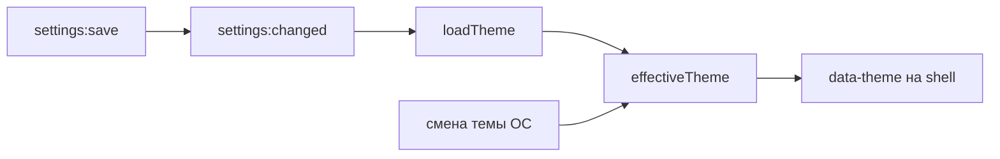

# 🧠 Состояние shell

Документ описывает состояние shell: вкладки, тему, подписки на main.

## 🧩 Вкладки

`useTabs.ts` держит `tabs`, `activeTabId`, `isIncognito`, `openGroups`, `savedGroups`, `stripOrder`, `pinnedStripOrder`. Стартовая загрузка идет через `listTabs`, дальше состояние пушится через `tabs:state` и `tabs:navigated`. Шаблоны групп синкаются через `groups:changed`. Инкогнито красит shell темным акцентом.

## 🎨 Тема

`useTheme.ts` держит `theme` и `effectiveTheme`. `system` резолвится через `matchMedia`, смена ОС пересчитывается подпиской. `loadTheme` читает настройки при старте и на каждом `settings:changed`. Тот же колбэк получает поле `locale` и вызывает `changeLanguage` (i18n shell, см. [I18N.md](../../shared/i18n/I18N.md)): стартовый язык shell читает из настроек до `app.mount()`.

## 🔀 Подписки

Shell слушает `tabs:state`, `tabs:navigated`, `tabs:tab-action`, `settings:changed` (тема, скругление, F11-режим, поле `locale`), `window:maximized`, `window:fullscreen`, `window:content-fullscreen`. Опрос таймером не используется.

## ⌨️ Клавиши shell

`onKey` в `App.vue` обрабатывает горячие клавиши shell: обновить/закрыть/создать вкладку, поиск, инструменты разработчика, полный экран. Сочетания берутся из настроек — реестр `shared/hotkey-actions` и разбор `shared/hotkeys` (`parseAccelerator`/`matchesInput`) общие с main, поэтому переназначенная в настройках клавиша работает и здесь, а старая перестаёт. Состояние сочетаний приходит при старте (`getSettings`) и по `settings:changed` (поле `hotkeys`). Пустое значение в `hotkeys` — снятое сочетание, а не дефолт: поле перекрывает `DEFAULT_HOTKEYS` пустой строкой, разбор её не находит, и действие не срабатывает.

Это дублирующая точка к `before-input-event` окна в main, а не замена: событие стреляет только в том `webContents`, который в фокусе, поэтому из адресной строки или панели вкладок клавиша иначе не дошла бы до main. Решение принимается в main, оттуда же возвращается состояние в `tabs:state`. Дубль не даёт двойного срабатывания: main первым гасит событие через `preventDefault`, и до renderer оно доходит только там, где обработчик окна не выстрелил.

## 🔒 Лок оформления

Кастомный компонент фиксирует свое оформление оберткой `.theme-lock`: внутри нее CSS-переменные зафиксированы на dark и тема браузера не влияет. Реестр компонентов живет в `registry.ts`.
