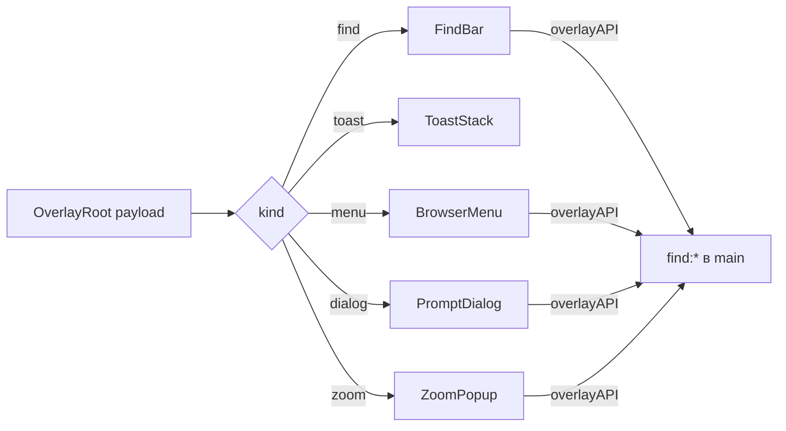

# 💬 Overlay UI

Документ описывает Vue-панели overlay-окна: корень, виды панелей, поиск, стили.

## 🧩 Корень

`OverlayRoot.vue` держит стек уровней и подписки на IPC, разбор payload (типы push, пропсы уровней, мерж патчей, сверка устаревших push) — в `payload.ts`, выбор компонента — в `registry.ts`. Тема (`dataset.theme`), класс `no-anim` и язык из `PushMessage.language` ставятся до установки payload (см. [I18N.md](../../shared/i18n/I18N.md)). Пустой payload показывает ошибку. Клик по прозрачной области закрывает окно без выбора.

## 🗂️ Панели

`BrowserMenu.vue` рисует пункты и инкогнито-бейдж, `WindowMenu.vue` — меню окна (тот же `MenuList`, другой источник пунктов). Пункт группы показывает заданные иконку, название и цветную точку (`color`). `ToastStack.vue` показывает уведомления. `PromptDialog.vue` запрашивает ввод для переименования и цвета. `IconDialog.vue` — общий диалог иконки для вкладок и групп: поле ввода плюс кнопки URL, файл, emoji и отмена; тип источника верифицирует main (`verifyIconSource`). `FindBar.vue` висит над страницей с опциями как в VS Code. `ZoomPopup.vue` управляет масштабом страницы: поле процента, кнопки `−`/`+` и `Reset`; поле первое в DOM ради автофокуса, визуальный порядок `− N% +` задает flex `order`.

## 🔍 Поиск

`FindBar` шлет `findQuery`, `findNext`, `findPrev`, `findClose` через `window.overlayAPI`. Опции: `matchCase`, `wholeWord`, `useRegex`. Счетчик обновляется через `.find-count`.

## 🎨 Стили

`overlay.css` красит панели через те же переменные shell по `data-theme`. Анимация fade длится 60ms и отключается классом `no-anim`. Кастомные панели фиксируются классом `.theme-lock`.

## 🎨 Оформление меню

Все меню рисует один компонент `MenuList.vue`: вкладки, группы, панель, браузер, окно. Клавиатурная навигация — roving tabindex, а не `tabindex` на каждом пункте, иначе Tab перебирал бы все пункты подряд. Стрелки пропускают `disabled` и разделители, `Home`/`End` прыгают к краям, первая буква переводит к следующему пункту на эту букву, а активный пункт подкручивается в вид (`scrollIntoView`).

Разделители реализованы и не используются: контракт `MenuItem.separator` (`shared/overlay-types.ts`), отрисовка `
`. Разделитель не получает фокус — `selectable` его исключает, поэтому стрелки его перешагивают. Включается пунктом `{ id: 'sep-N', label: '', icon: '', separator: true }`.

**Состав пункта настраивается.** `MenuDisplay` (`shared/overlay-types.ts`) приходит в `PushMessage.menuDisplay` — одним полем на всё сообщение, а не на уровень: все меню на экране обязаны выглядеть одинаково. Управляет тремя частями: иконкой, текстом и подписью горячей клавиши (`MenuItem.hotkey`). Правило живёт в `MenuList` — единственной вёрстке пункта, поэтому действует во всех меню (вкладки, группы, панель, браузер, окно, страница). При `display.hotkeysOnHover` подпись скрыта и проявляется только на активном пункте — при наведении мыши или выборе стрелками (тот же класс `menu-item--active`, что несёт подсветку). При включённом тексте он лежит в растущем `span` и прижимает подпись хоткея к правому краю; при выключенном распорка убирается (см. `menu-list--no-label` ниже), и подпись идёт вплотную за иконкой.

**Ширина карточки меняется по схеме отображения.** Четыре режима через класс на `.menu-list`: **`menu-list--icons`** (нет текста и нет подписей) — `min-width: 0`, `max-width: 60px`: карточка ~50 px по размеру эмодзи, пункт центрируется, боковые отступы ужаты; **`menu-list--hotkeys`** (нет текста, подписи есть) — `min-width: 0`, `max-width: 320px`: компактная по содержимому, иконка и подпись стоят рядом; **`menu-list--wide`** (текст и подписи) — `min-width: 260px`, `max-width: 480px`: шире обычного, чтобы подписи встали столбцом у правого края; иначе — обычные 220…320.

При отключённом тексте класс `menu-list--no-label` убирает распорку `.menu-label` совсем (`display: none`) и снимает левый отступ у подписи. Это принципиально: распорка с `flex: 1` раздвигала пункт, и между иконкой и хоткеем оставалась дыра во всю ширину карточки. Без неё иконка и подпись идут вплотную, а подписи выравниваются в столбец сами (иконка фиксированной ширины 20 px — общая точка старта).

«Широкий» включается, только если подпись есть ХОТЬ У ОДНОГО пункта ЭТОГО меню: у меню без хоткеев расширяться незачем. Потолок в main (`geometry.ts`, `menu`/`window-menu`) — 840: 480 карточки, внешние поля, зазор и место под боковую панель подпунктов (см. ниже). Само меню до потолка не дорастает: его ширину держит CSS по схеме отображения, а потолок ограничивает только выброс содержимого. Подписи хоткеев выравниваются в столбец сами: карточка одной ширины на все пункты, а подпись прижата к правому краю.

**Строка-справка и отдельная кнопка-действие.** Схема пункта разрешений: слева название (просто текст), справа — отдельная квадратная кнопка действия (🗑️). Признак строки — `MenuItem.plain`; вместе с ней ставится `actionIcon` (и `actionTitle` — подсказка). Строка рендерится `div`-ом, а кнопка действия — НАСТОЯЩЕЙ `<button>`: пока кнопкой была сама строка, корзина оказывалась вложенной в кнопку — и по разметке (вложенный `<button>` невалиден), и на вид («кнопка в кнопке»). Для обычного пункта (`plain` не стоит) кнопка остаётся `span` с `role="button"`: `div` внутри `<button>` тоже невалиден. Поэтому элемент выбирается через `<component :is>`: `plain` → `div` + `button`, иначе → `button` + `span`.

У строки-справки нажатие мыши НЕ обрабатывается: название — не действие, единственная его цель — кнопка. Подсветка при наведении поэтому снята (`cursor: default`, `.menu-item:hover:not(.menu-item--plain)`), и `onEnter` не делает такую строку активной — иначе название подсвечивалось бы как кнопка. С клавиатуры строка остаётся достижимой: стрелки на неё встают (подсветка `menu-item--active` — индикатор позиции, без неё не видно, где стоишь), Enter выполняет то же, что корзина. Иначе снять решение без мыши было бы нечем.

Квадрат 26×26 (`inline-flex` + центровка): эмодзи в строчном элементе с паддингом по тексту резался по высоте, и кнопка читалась как узкая полоска. Рамка видна ВСЕГДА — без неё корзина читается как украшение строки, а не как то, что можно нажать. `actionIcon` расширяет карточку так же, как подпись хоткея (режимы `wide`/`hotkeys`), и настройкой видимости частей пункта НЕ управляется: это действие, а не оформление.

**Заголовок группы внутри меню.** `MenuItem.heading` (ставится вместе с `disabled`) рисует пункт подзаголовком: он не нажимается и пропускается клавиатурной навигацией, но класс `menu-item--heading` возвращает ему цвет `--ov-text` и обычный размер. Правило `.menu-item--heading:disabled` стоит ПОСЛЕ `.menu-item:disabled`: специфичность у них равная, решает порядок. Затемнять заголовок нельзя — он делит список на группы, и на тёмной теме серый (#666) делал его наименее читаемой строкой меню.

**Полнота иконок.** Приложение стремится к 100 % покрытию пунктов иконками: у каждой текстовой подписи есть иконочный аналог, поэтому меню остаётся читаемым при отключённых названиях (`menuShowText: false`) — вплоть до режима «только иконки». Правило не распространяется на процедурные пункты, чья иконка приходит в runtime: например, значок расширения в меню расширений подставляет источник данных, а не сборщик меню, — заранее покрыть такой пункт статической иконкой нельзя.

Инвариант «включена хотя бы одна идентифицирующая часть — иконка или текст» (хоткей в него не входит) держит `settingsStore` (см. [STORES.md](../../main/store/STORES.md)). Исключение по раскладке — `ExtensionsMenu.vue`: у него своя вёрстка (значок, имя, закрепление), а не `MenuItem`-список.

## 🗂️ Боковая панель подпунктов

Пункт с `MenuItem.children` раскрывает подменю СБОКУ — так устроен пункт «История» в меню браузера: возврат последней закрытой записи и список недавно закрытых вкладок и окон. Панель — тот же `MenuList`, отрисованный вложенно (`последовательный импорт себя же`), поэтому вёрстка пункта, ширина по схеме отображения и клавиатура не дублируются.

Правила поведения:

- панель открывается по наведению (мышью) и по `Enter`/`ArrowRight` (клавиатурой), по `ArrowRight` фокус переезжает в неё; `ArrowLeft` возвращает в родительский список;
- пункт с подпунктами САМ не выбирается: и `Enter`, и клик только раскрывают панель, а действие — у её пунктов;
- наведение на пункт без подпунктов закрывает панель — иначе она висела бы над соседними пунктами;
- панель не забирает фокус при монтировании (`autofocus: false`), иначе наведение мышью отбирало бы клавиатуру у меню;
- стрелка `›` в пункте показывает, что за ним есть второй уровень.

Геометрия — две вещи, без которых панель не работает:

- **котейнер, а не абсолютное позиционирование.** Карточки лежат в `.menu-frame` с `display: flex` в один ряд, и боковая панель — ВТОРОЙ ребёнок. Окно оверлея измеряется по `.overlay-level`, и только сосед в потоке добавляет ему место; абсолютно спозиционированная панель не вошла бы в `getBoundingClientRect` и была бы срезана краем окна.
- **снятие потолка на время панели.** `.overlay-level` держит `max-width: 100%`, чтобы карточка не вылезала за окно, посчитанное по прошлому замеру. Панель эту границу обязана пересечь, иначе замер видит ширину, равную окну, и окно никогда не вырастет. Пока панель открыта, `MenuList` ставит на `<html>` класс `overlay-flyout`, а `overlay.css` снимает `max-width`. Замерено: без класса окно оставалось 484 px при содержимом 624, с ним становится 625.

Сторона раскрытия — от выравнивания меню (`align`): у меню, прижатого правым краем к кнопке (`end`, кнопка ☰), панель растёт ВЛЕВО и карточка меню остаётся на месте; у меню от левого края (`start`, контекстное) — вправо (`flex-direction: row-reverse`). Потолок ширины меню в main (`geometry.ts`) поднят до 840 = 480 карточка + поля + зазор + 320 панель: меню без подпунктов до потолка не дорастает, его держит CSS.

## 🧩 Общий каркас диалога

`DialogForm.vue` — общий каркас диалога: заголовок, одно поле ввода и ряд кнопок. На нём стоят `PromptDialog.vue` (переименование, цвет) и `IconDialog.vue` (источник иконки), поэтому раскладка и клавиатура описаны один раз.

- Кнопки описываются данными: `id`, `label`, `icon`, `title` и `group`. Группа `sources` собирает кнопки-источники слева (`sourceButtons`), остальные — справа (`otherButtons`); отмена всегда последняя.
- Enter выбирает первую не-отменяющую кнопку (`defaultButton`); отмена приходит отдельным `id: '__cancel__'`.
- Escape в компоненте намеренно не ловится: окно оверлея слушает его глобально и закрывает сессию. Свой обработчик дал бы два `dismiss`.
- Клик по подложке (прозрачной области вокруг диалога) закрывает без выбора; проверка `target === currentTarget` отличает его от клика внутри диалога.
- Поле получает фокус и выделение при монтировании.

## 🛠️ Проблемы и решения

### 📏 `no-anim` только на `<html>`

Флаг анимаций ставится на `document.documentElement` синхронно при разборе payload, а не реактивно на `.overlay-root`. CSS-анимация `overlay-fade` стартует в том же кадре, что монтируется Vue: класс на `.overlay-root` успевает примениться **после** старта анимации, и fade проигрывается даже при `animations: false`.

### 🔤 Общий каркас диалога теряет смайлики и раскладку

**Симптом (регрессия шага 7).** В диалоге иконки пропали смайлики у кнопок
(`🔗 URL`, `📁 File`, `😀 Emoji`), кнопки встали в один ряд, и `Cancel`
оказался вплотную к источникам.

**Причина.** `IconDialog` стал обёрткой над `DialogForm`, и его кнопки
описывались данными: `{ id, label }`. Смайлик, подсказка и принадлежность к
группе «источники» в этой модели не помещались — тип их не знал. Разметка
при этом осталась верной: кнопки выводились, но уже без иконок и в один
ряд, потому что `dialog-actions` стал `justify-content: flex-end` без
вложенной группы.

**Исправление.** В `DialogForm` добавлены `icon`, `title` и `group` в
описание кнопки, две вычисляемые группы `sourceButtons` / `otherButtons` и
исходная раскладка с двумя блоками.

**Про перенос в общий компонент.** Данные, которых нет в типе, не
переносятся молча: они выпадают без ошибки компиляции. При вынесении
разметки в общий компонент нужно сравнивать свойства передаваемых данных с
исходной разметкой, а не только смотреть, что `typecheck` зелёный.
